# WeakSquare Chess Trainer: User Guide

WeakSquare Chess Trainer is a Windows desktop app for training chess tactics on the Lichess puzzle database. You choose exactly which puzzles you get (themes, rating, length, side), solve them on a board, and over time the app helps you find and fix the gaps in your play.

This guide covers **only what the app does today**. Each section says which version added it. For what changed in each version, see [CHANGELOG.md](../CHANGELOG.md).

<!--
Planned chapters, added only when their version ships (see CLAUDE.md "Documentation"):
  Getting started: first run and the puzzle download ......... v0.1
  Choosing your puzzles (filters, queue) ...................... v0.1, v0.2
  Solving a puzzle (the trainer, the session bar) ............. v0.1
  Presets and stats ........................................... v0.2
  Signing in with Lichess, syncing solves, offline mode ....... v0.3
  Getting unstuck: hints and the engine ....................... v0.4
  Training modes .............................................. v0.5, v0.6
  Mistake reasons ............................................. v0.6
  AI explanations and what they cost .......................... v0.7
  Your game library and Game Review ........................... v0.8, v0.9
  Importing your own puzzles .................................. v0.8
  The Coach ................................................... v0.10, v0.11
  Tracking your progress ...................................... v1.0
  Installing from source and updating ......................... v0.1, v1.0
  The About screen ............................................ v0.1
  Troubleshooting ............................................. grows each version
-->

## Your data and privacy
*Added in v0.1.*

- **Where your data lives:** everything is stored on this PC under `%LOCALAPPDATA%\WeakSquare`.
  - `puzzles.db` is the imported Lichess puzzle database. It's large but rebuildable: re-importing replaces it.
  - `user.db` holds everything you create: your attempts, presets and settings, and from later versions your games and analysis. Back up this file to keep your history.
  - Before an update changes `user.db`, the app saves a copy in the `backups` folder next to it and keeps the last five.
- **Sign-ins and API keys** are never written to files. Your Lichess sign-in (from v0.3), and from v0.7 any AI provider key, are stored in **Windows Credential Manager**. Signing out removes them. Each data folder has its own entry, so a test or development copy of the app never sees your real sign-in.
- **Nothing leaves your PC** unless you use a feature that needs the internet. Those features are listed in their own sections, along with what they send.
  - **Puzzle database download** (v0.1): requests the public puzzle file and its checksum list from database.lichess.org. Nothing else is sent.
  - **Update check** (v0.2): at most once a day, and when you click **Check for updates**, the app makes three plain requests to database.lichess.org: the checksum list (`sha256sums.txt`), the puzzle file's date and size (a `HEAD` request, which doesn't download it) and the front page, for the approximate puzzle count. Nothing about you or your training is sent. Turn it off in **☰ → Settings…**.
  - **Lichess sign-in and sync** (v0.3), only while you're signed in. See [Signing in with Lichess](#signing-in-with-lichess-syncing-solves-offline-mode) for when each happens. All of it goes to lichess.org over HTTPS:
    - **Signing in** opens lichess.org in your browser. The app then exchanges a one-time code for your sign-in.
    - **Your account:** your username and puzzle rating are read at start-up and after signing in.
    - **Your solves:** for each puzzle you finish, the app sends its ID, whether you solved it, whether it's rated, and the theme you chose it by (the *angle*, for example `mix` or `fork`). Nothing else about your session is sent.
    - **Your puzzle history:** the puzzles you've played on Lichess are read once, then only new ones.
    - **Signing out** tells Lichess to cancel your sign-in.
  - **Stockfish download** (v0.4): installing Stockfish (from setup, `fetch_stockfish.py` or the **Install Stockfish** button) downloads one file, the official Stockfish 19 Windows build, from github.com. Nothing about you is sent. The engine itself runs entirely on your PC and never uses the internet.
  - **AI explanations** (v0.7), only if you set up an AI provider and press **Explain** (or **Test key**). They go over HTTPS to the provider you chose, api.anthropic.com or api.openai.com, with your API key. See [AI explanations and what they cost](#ai-explanations-and-what-they-cost).
    - **Explain** sends one puzzle: its position (FEN), the solution moves, its themes, the moves you played, Stockfish's lines and its answer to your wrong move, and facts about which pieces attack and defend which squares. In Danger spotting it also sends the highlighted move and your call. It never sends the puzzle's ID or rating, your Lichess name, your settings or anything about other puzzles. OpenAI requests ask it not to keep the response for later retrieval (`store: false`); each provider's own data policy applies.
    - **Test key**, and the silent check of a saved key at start-up, only ask the provider whether the model exists. That's free and sends no puzzle.
    - **Explain this move** (v0.9) sends one move of one of your games: the position before it (FEN), the move you played and its grade, Stockfish's evals before and after it, its best line and top lines from that position, its reply to your move, the game phase and move number, and the attack and defence facts. Nothing else about the game.
    - **Explain my game** (v0.9) sends one game: which color you played, the result from your side (won, lost or drawn), the game's moves in SAN (for example `1. e4 e5 2. Nf3`), how many inaccuracies, mistakes and blunders Stockfish found for you, and for each key moment the same facts as Explain this move. The app rebuilds the move list from the moves themselves, so **no player names, ratings, dates, links, clocks, comments or other PGN headers are sent**, and no game ID. The players are "you" and "your opponent". It also sends the list of puzzle themes the model may recommend from.
    - **Get AI coaching** (v0.10, the Coach) sends one report: its numbers (how often each weakness happened per 10 games, how much it cost, your mistake-reason counts, the puzzles-vs-games table, your puzzle accuracy per theme) and 12 example positions (20 at **Detailed**), each as a position (FEN), the move played, Stockfish's best line and its themes, labelled E1, E2 and so on. **No player names or usernames, no dates, links, clocks, game IDs or PGNs** are sent, whoever the report is about. It also sends the list of puzzle themes the model may recommend from.
      - *From v0.11*, a **standard run** on a report with games also sends the whole-game measures and one summary per game, labelled G1, G2…: which color you played, the result, the opening's name and ECO code, the number of moves, when each side castled, your development by move 10, the pawn structure at move 15, trades made while ahead or behind, the eval at move 15, mistakes per phase, the endgame type, whether you held +2 or −2, your mistakes under 10% of your clock, and 3 key moments (5 at **Detailed**), each as a position (FEN), the move with its number and the best move in SAN, the evals, the grade, Missed or Allowed, its Lichess themes, the reason you picked for it (for example *didn't look*), and your clock as a **percentage** of your starting time, never the clock itself. The report's numbers still include the puzzles-vs-games table. Example positions carry their game label and move number. It also sends the list of lesson topics the AI may pick from. Still no names, usernames, ratings, dates, links, raw clocks, comments, game IDs or PGNs.
      - **Advanced analysis** (v0.11, off unless you tick it) also sends the moves of up to your chosen number of games (10–50) in SAN only, rebuilt by the app from the moves, so no PGN headers, clocks or comments.
      - **Include my notes** (v0.11, off unless you tick it) also sends your mistake-reason notes, exactly as listed in its preview, with web addresses removed.
    - What each request cost is kept in `user.db`, on this PC only.
  - **Your games** (v0.8), only for accounts you link. Each sync fetches game metadata and PGNs, never analysis, and sends nothing about you beyond the request itself:
    - **Lichess:** with your sign-in, your own games since the last sync, from lichess.org (`/api/games/user/<you>`).
    - **chess.com:** your linked username's public monthly game archives from api.chess.com, one request at a time. chess.com's public API needs no login. **Verify** looks up that username's public profile.
    - **Importing by URL** fetches that one game: from lichess.org, or by searching your chess.com archives of the last six months.
    - **The analysis runs on your PC.** Stockfish grades your games locally, and the games and their analysis stay in `user.db`. Only the AI buttons (v0.9) send anything about a game, as described under AI explanations above.
    - **Open on Lichess / chess.com** opens the game's page in your browser, like any link.
  - **The Coach** (v0.10):
    - **Your games:** a run on your own games first syncs your linked accounts, exactly like **Refresh** in My games. All the analysis, tagging and puzzle-making happens on your PC.
    - **Another player's games:** when you enter someone's username, the app fetches that player's **public** games: from lichess.org (`/api/games/user/<name>`, with your sign-in when you're signed in, which Lichess allows at a faster rate) or from their chess.com monthly archives, one request at a time. They're stored in `user.db` with their own label.
    - **Your Lichess puzzle dashboard:** with the **Puzzle history** or **Both** source and while you're signed in, the app reads your per-theme puzzle results for the last 30 days from lichess.org (`/api/puzzle/dashboard/30`). Nothing is sent but the request.
    - The report, the Suggested mix and the puzzles made from your games stay in `user.db`. Only **Get AI coaching** sends anything about them, as described under AI explanations above.
  - **Importing your own puzzles** (v0.8): the file is read on your PC and **never sent anywhere**.
  - **Name the idea first, Danger spotting and mistake reasons** (v0.6) send nothing. Danger-spotting results are never synced to Lichess, and your mistake reasons and notes stay in `user.db`.
  - **Links that open your browser** (v0.1): **Open this puzzle on Lichess** (after a puzzle) and the **Source code** link on the About screen open the page in your default browser, like any link you click. The app itself sends nothing.
    - **Lesson pointers** (v0.11) open Lichess Practice or Lichess Learn pages, or a search on YouTube, chess.com or your own site, in your default browser. A search sends the topic's words (for example *chess rook endgames*) to the site you click, and nothing else. The app never visits those sites itself.

## Getting started: the puzzle database
*Added in v0.1. Changed in v0.2: the wording says what you download.*

WeakSquare trains on the Lichess open puzzle database, which is public domain. **Download from Lichess** fetches the **entire** database, every puzzle and not a sample: about 300 MB compressed, about 6 million puzzles, and roughly 1.5 GB on disk once imported. It's stored on your PC, so after the first download everything works offline. With every filter cleared, including the quality filter under **More filters**, the match count equals the number of puzzles imported. With the default quality filter on, it's lower (see *Choosing your puzzles*).

If setup already imported it, the app opens straight to your puzzles. Otherwise the first screen is **Get the puzzle database**:

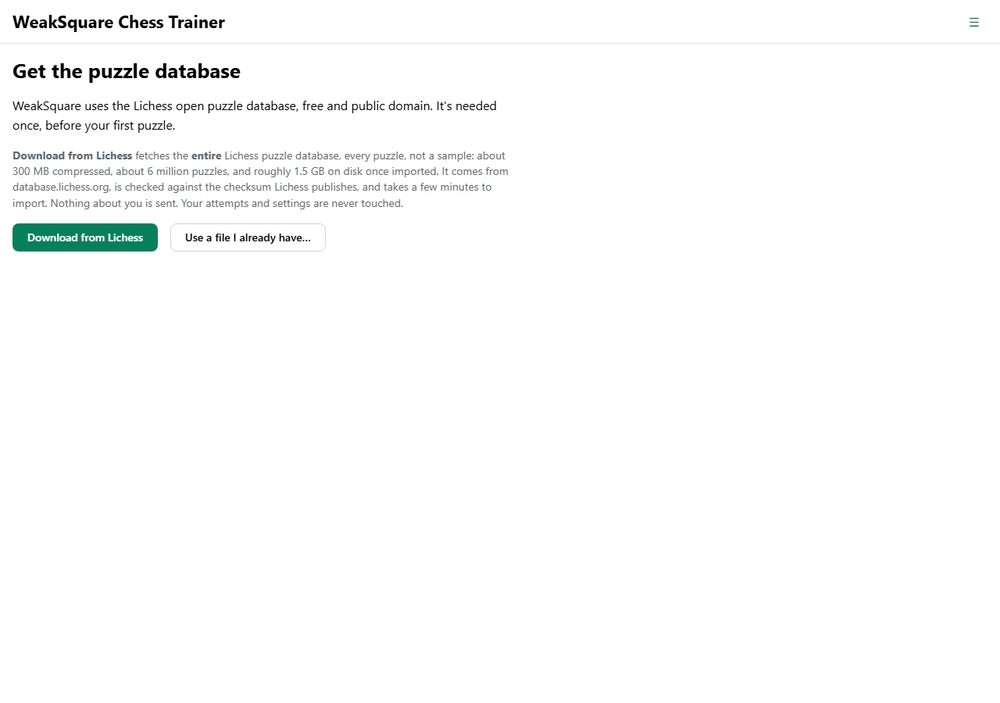

1. Click **Download from Lichess**. The app downloads the whole database (about 300 MB), checks it against the checksum Lichess publishes, and imports it. Expect a few minutes; the progress bar shows each stage. Make sure you have about 2 GB free: the download and the imported database (about 1.5 GB) are both on disk until the import finishes.
2. When it's finished, the app switches to your puzzles.

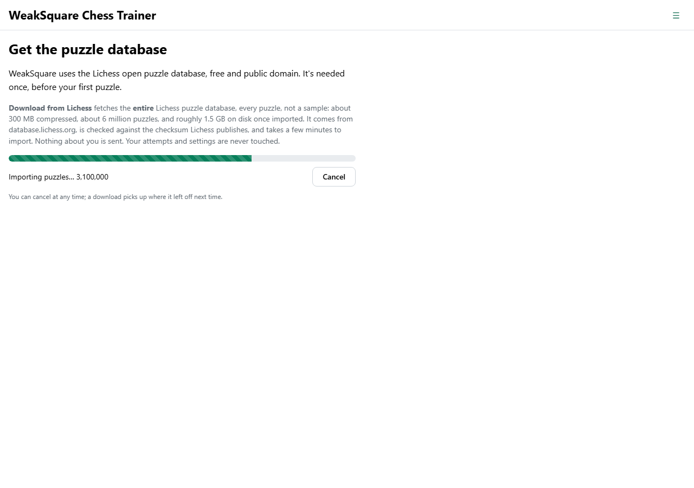

**Already have the file?** Click **Use a file I already have…** and choose a `lichess_db_puzzle.csv.zst` (or an unpacked `.csv`) from database.lichess.org.

**Updating:** Lichess publishes a new export regularly, and the app tells you when there is one (see [Keeping the puzzle database up to date](#keeping-the-puzzle-database-up-to-date)). You can also choose **☰ → Update puzzle database…** at any time. You can keep training while it runs; the new puzzles are switched in when it's finished.

**The one-time upgrade** (*Added in v0.2*): the first time v0.2 starts, it shows **Upgrading your puzzle database**. The opening and quality filters need extra information in the database, so the app rebuilds it once from the copy you already have. Nothing is downloaded, it takes about 2 minutes, and your attempts and settings aren't touched. If it stops (for example, you close the app), it starts again next time and your current database keeps working until it finishes.

**Gotchas**
- **Cancel** stops at any point and leaves your current puzzles as they were. An interrupted download picks up where it stopped next time.
- If the download doesn't match Lichess's checksum, it's deleted and nothing changes. Try again later (Lichess may be updating the file).
- Importing never touches your attempts or settings.
- **What it sends:** the download is a plain file request to database.lichess.org. Nothing about you or your training is sent.

## Signing in with Lichess, syncing solves, offline mode
*Added in v0.3.*

Signing in is optional. When you're signed in, every puzzle you finish is also recorded on your Lichess account, your Lichess puzzle rating is shown in the app, and you can leave out puzzles you've already played on Lichess.

### The startup page
The app opens on a startup page every time.

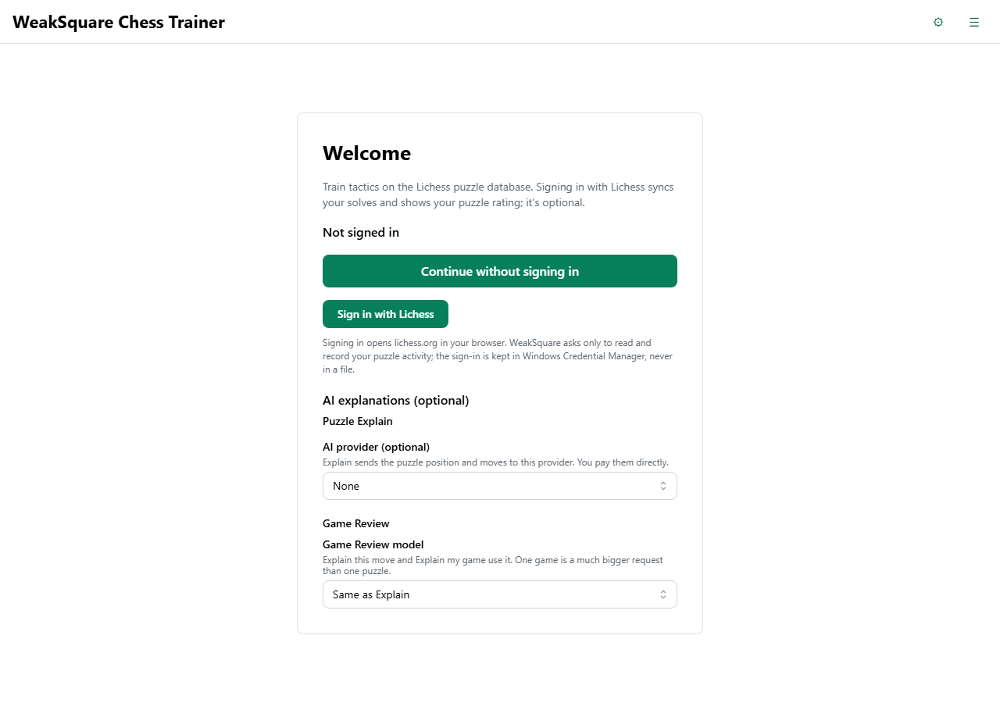

- **First time, or signed out:** the page says *Not signed in*. Click **Sign in with Lichess**, or **Continue without signing in**.
- **Signed in:** one button, **Continue as *your name***. **Show all options** reveals **Sign out** and **Sign in as someone else**.
- **Lichess can't be reached** (for example, no internet): your sign-in is kept and the button says **Continue offline as *your name***. Your solves are saved here and sync later.
- *Changed in v0.7:* **AI explanations (optional)** appears under **Show all options** (and whenever you aren't signed in): the provider, model and API key. See [AI explanations and what they cost](#ai-explanations-and-what-they-cost). If you saved a key, the app checks it quietly at start-up; when the check fails, the page opens with all options and says why, so you can fix the key or carry on without AI.
- **Your sign-in expired or was revoked** (Lichess sign-ins last about a year): the page says so and asks you to sign in again. If it happens while you're training, a banner with **Sign in again** appears above your puzzles; your solves wait until you do.

### Signing in
1. Click **Sign in with Lichess**. Lichess opens **in your usual web browser**, not inside WeakSquare, so your password manager and two-factor sign-in work as normal.
2. Sign in to Lichess if you aren't already, and approve WeakSquare. It asks only to read and record your puzzle activity (`puzzle:read` and `puzzle:write`).
3. The browser says *"Signed in. You can close this tab and return to WeakSquare."* The app comes back to the front and shows **Signed in as *your name***.

While you're in the browser, the app shows *Waiting for you in your browser…* with **Cancel**. After 5 minutes it stops waiting and you can try again. If it fails, the reason is shown (for example *Sign-in failed: Lichess refused the request*). You can always continue without signing in.

### Your puzzle rating
While you're signed in, the top bar shows **Puzzle rating 1834**, with a **?** after it while Lichess still calls your rating provisional. The number always comes from Lichess. The app never calculates or estimates it, so it matches lichess.org.

After each puzzle, the result panel shows its **Lichess rating** change, e.g. **+8** in green or **−12** in red, usually within a second or two. Until Lichess replies it says **Syncing…**. When there's no number, it says why:
- **Will sync later:** you're offline or not signed in. The number fills in once the solve has synced.
- **Unrated (Rated is off):** you switched off **Rated** for this session (below).
- **Already played: rating unaffected:** you've played this puzzle on Lichess before, and Lichess only rates your first try.
- **Not rated by Lichess:** Lichess returned no change.

A puzzle you've already played on Lichess, or solved here and synced (or waiting to sync), also shows the badge **Already played: rating unaffected** while you solve it. *Changed in v0.5:* it used to say "on Lichess", and was cut off in a narrow window.

The session bar adds **+34 this session**, the total of the changes Lichess returned this session. The rating trend over time is on the Stats page.

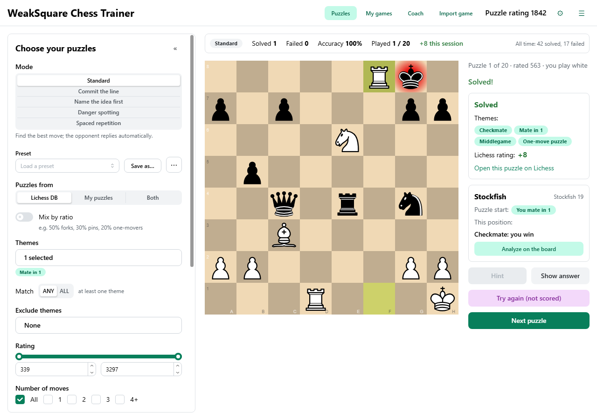

**Why do themed sessions move my rating so little?** Lichess weighs a solve by what you knew in advance. If you choose only forks, you know a fork is coming, so a win counts for about a fifth of a normal one. WeakSquare reports this honestly as the *angle*:
- It's `mix` only when the themes are **All**, the number of moves is **All** and you're not using ratios.
- Otherwise it's the theme you chose that the puzzle has. Motifs (fork, pin…) come before phases and goals (endgame, crushing…).
- If you narrowed only the number of moves, it's the length (one-move, short, long or very long).

Excluded themes, openings, rating, side and quality don't change it.

### Rated
The **Rated** switch above **Start** applies to the session you start. It's on every time you open the app. Switch it off to practise without risking your rating: your solves are still recorded on Lichess, as unrated.

### Syncing and offline mode
- Solves sync right away when you're signed in, and syncing never slows down solving.
- Offline, or before you sign in, solves wait on this PC. The top bar says **Offline: 3 solves waiting to sync** (or **Not signed in: 3 solves waiting to sync**). They're sent automatically when Lichess can be reached again, or when you next sign in. Nothing is lost if you close the app.
- A solve made while signed in to one Lichess account only ever goes to that account. Solves made while signed out go to the next account you sign in with.
- Puzzles you played before v0.3 aren't sent to Lichess. They were recorded before the app knew whether they were rated or which theme you chose them by, and they still count in your Stats.
- If Lichess asks the app to slow down (it allows about 200 solves an hour), the app waits at least a minute before sending anything again, even if you keep solving. The top bar shows how many solves are waiting.

### Excluding puzzles you've played on Lichess
When you sign in, the app reads which puzzles you've played on Lichess, then only the new ones each time. **More filters → Your history → Exclude played on Lichess** (on by default) leaves those puzzles out, along with every puzzle you've synced from here, because Lichess wouldn't rate them again. Untick it to get them back. While you're signed out with no history read yet, it's greyed out.

### Signing out
Open the gear (**⚙**, top right) and choose **Sign out** under **Lichess account**. The app cancels your sign-in on Lichess, then removes it from Windows Credential Manager. Solves still waiting to sync stay waiting.

If Lichess can't be reached, the app asks before removing anything. **Remove from this PC anyway** deletes it here; cancel it yourself later at lichess.org/account/security (*Sessions*/*API access tokens*).

**Gotchas**
- **Sign in as someone else** uses whichever account your browser is signed in to on lichess.org. To switch accounts, sign out of lichess.org in your browser first (or sign in there as the other account).
- After signing in, if the browser tab doesn't close itself, just close it.
- The app may not come back in front of the browser on its own (Windows sometimes blocks that). Click it in the taskbar.
- Your sign-in is stored in Windows Credential Manager under **weaksquare** (Control Panel → Credential Manager → Windows Credentials).

## Keeping the puzzle database up to date
*Added in v0.2.*

Once a day, when you start the app, it checks quietly in the background whether Lichess has published a newer puzzle export. It never interrupts a puzzle. When there's one, a banner appears above your puzzles:

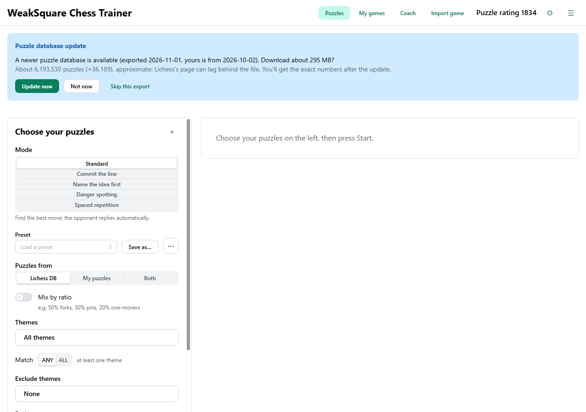

- **Update now** downloads and imports the new export, exactly like **☰ → Update puzzle database…**. You can keep training meanwhile. When it's finished, the dialog shows the exact numbers, for example *"6,193,530 puzzles: 44,112 new, 7,923 removed."* Your attempts on removed puzzles stay in your history and Stats.
- **Not now** hides the banner until the next time you start the app.
- **Skip this export** stays quiet until Lichess publishes a newer export than this one.

The banner's puzzle count comes from the database.lichess.org page, which can lag behind the file, so it's labeled approximate. If the page can't be read, the line is left out and everything else still works.

**Checking yourself:** **☰ → Update puzzle database… → Check for updates** checks right away, even if the app already checked today, and says what it found.

**Turning it off:** **☰ → Settings… → Check for a newer puzzle database once a day.** Check for updates still works.

**Gotchas**
- Offline, the check stays silent and simply tries again at the next start.
- A database imported from a file you chose has no checksum to compare, so the app compares the export dates instead.
- See [Your data and privacy](#your-data-and-privacy) for exactly what the check sends.

## Choosing your puzzles
*Added in v0.1. Changed in v0.2: ratios, openings, quality, your history, order and presets. Changed in v0.3: Exclude played on Lichess, and Rated. Changed in v0.5: the Mode control, the Depth ladder order, and Hide filters.*

*Changed in v0.8: Puzzles from (Lichess DB / My puzzles / Both).*

The left-hand panel, **Choose your puzzles**, decides which puzzles you get. The count under the filters updates as you change them, so you always know how many puzzles match. The panel scrolls on its own, so the board stays in view. At its top, **Mode** picks how you train (see [Training modes](#training-modes)).

1. Under **Puzzles from**, choose **Lichess DB**, **My puzzles**, or **Both** (see [My puzzles](#my-puzzles)).
1. Pick **Themes**, or leave it at **All themes**. To mix themes in fixed shares instead, switch on **Mix by ratio** (below).
2. Choose **ANY** (a puzzle needs at least one of your themes) or **ALL** (it needs every one).
3. Narrow it down with **Exclude themes**, **Rating**, **Number of moves** and **You play**.
4. Open **More filters** for openings, quality and your history. Its summary line shows what's on, even while it's closed.
5. Choose the **Order**, then how many **Puzzles** you want, or switch on **Endless**.
6. Leave **Rated** on to count the session toward your Lichess puzzle rating (see [Rated](#rated)).
7. Press **Start**.

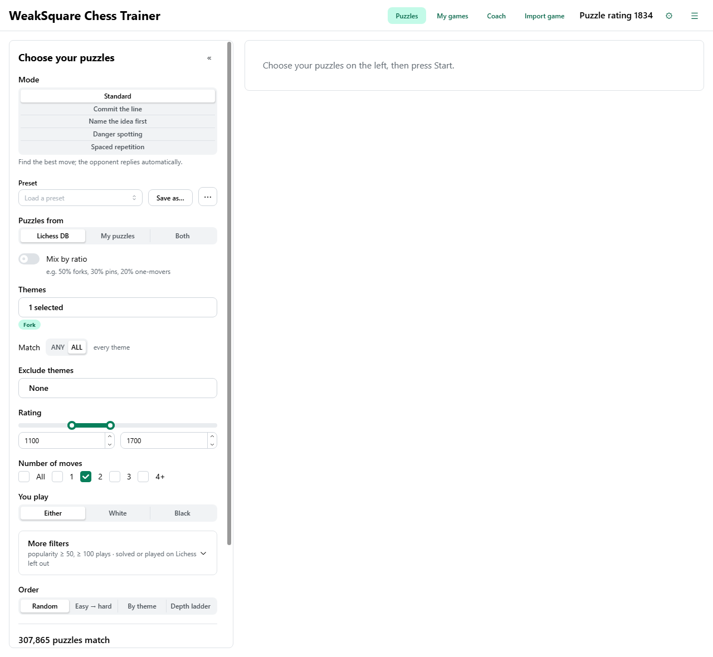

| Control | What it does |
|---|---|
| **Themes** | Opens a list of every theme in the database, grouped (Motifs, Advanced, Mates, Mate patterns, Phases, Special moves, Goals, Lengths, Origin) with how many puzzles have each. Type in **Search themes** to find one. **Select all** ticks every theme shown by the search; **Clear** unticks everything. Leaving it empty means all themes. |
| **Match: ANY / ALL** | ANY: puzzles with *at least one* chosen theme. ALL: puzzles with *every* chosen theme, e.g. Fork + Long finds long puzzles that involve a fork. |
| **Exclude themes** | Puzzles with *any* of these themes are left out, whatever else they match. |
| **Rating** | Drag either end of the slider, or type exact numbers in the boxes. A typed number applies when you press **Enter** or click elsewhere. If the maximum you type is below the minimum, the minimum moves down to match. The range runs from the easiest to the hardest puzzle in the database. |
| **Number of moves** | How many moves *you* make: 1, 2, 3 or 4 and more. Tick any combination, or **All**. This is counted from the solution itself, not from the One-move/Short/Long/Very long theme tags. |
| **You play** | White, Black or Either. |
| **Puzzles** / **Endless** | A session of a fixed number of puzzles (1 to 500), or an endless one. |
| **Preset** | Loads a saved set of filters. See [Presets](#presets). |
| **Mix by ratio** | Replaces **Themes** with groups, each with a share of the session, e.g. 50% Fork, 30% Pin or Skewer, 20% One-move. A group matches *any* of its themes. Each group shows how many puzzles it has, and the shares must add up to 100% (**Total** turns red until they do). **Add group** re-splits the shares evenly; **Even split** does that for the groups you have. Every other filter applies to all groups. Switching ratios off brings back the themes you had before. |
| **More filters → Openings** | Puzzles from the openings you choose. Type to search. Each opening family is listed with its variations; choosing **(any variation)** takes the whole family. Only puzzles that start before move 20 have an opening, so choosing one leaves out the rest. |
| **More filters → Quality** | **Min popularity** (Lichess players' votes, from -100 to 100) and **Min plays**. They're on by default at 50 and 100, which leaves out puzzles players rated poorly or that few have played. Change either number, or empty a box and press **Enter** to turn it off. |
| **More filters → Your history** | **Exclude solved here** (on by default) leaves out puzzles you've solved at least once in this app; ones you've only failed can still come up. **Exclude played on Lichess** (on by default, *added in v0.3*) leaves out puzzles in your Lichess history, which Lichess wouldn't rate again; it needs a Lichess sign-in. **Only my misses** gives you only puzzles whose last attempt here was a fail, so a puzzle drops out once you solve it. While it's on, the other two aren't needed and are greyed out. |
| **Order** | **Random**; **Easy → hard** (lowest rating first); **By theme**, which serves all the puzzles of your first chosen theme, then the next (with ratios: group by group); or **Depth ladder** (*added in v0.5*), which starts you on short puzzles and moves you up as your accuracy allows (see [Depth ladder](#depth-ladder)). |

No puzzle repeats within a session. Your filters are remembered the next time you open the app, and the count updates as you play, because solved puzzles drop out.

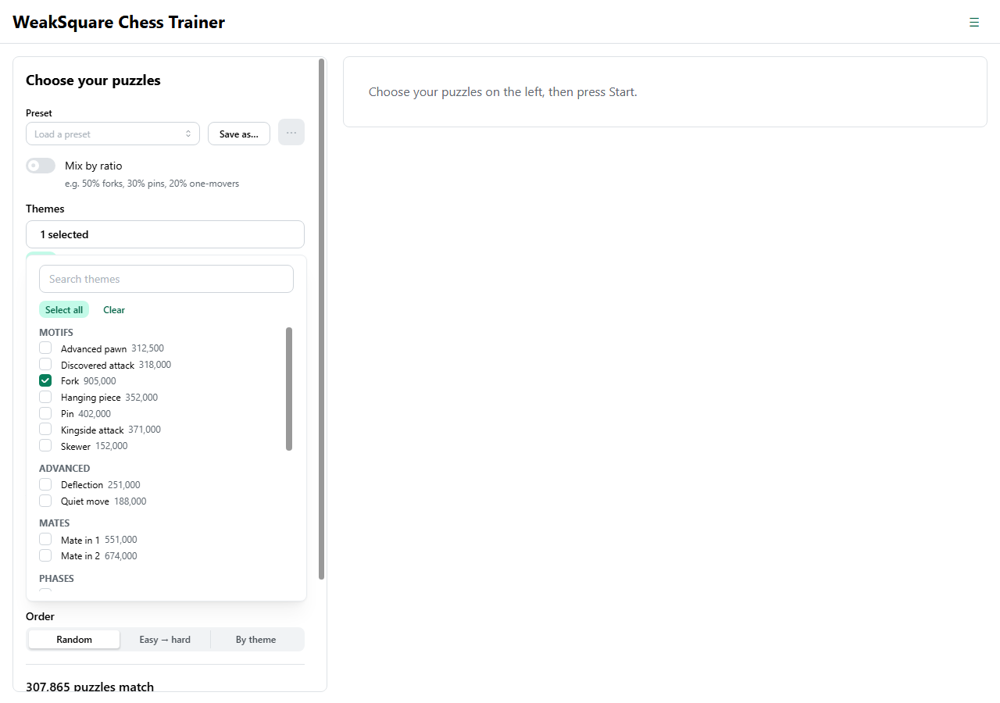

**Hiding the filters while you play** (*added in v0.5*): click **«** at the top of the panel (or press **F**) to fold it away. A slim bar takes its place with **» Show filters**, your mode, a summary of your filters and whether the session is Rated, and the board gets bigger. **Show filters** (or **F**) brings the panel back exactly as you left it. The app remembers whether it was hidden the next time you open it.

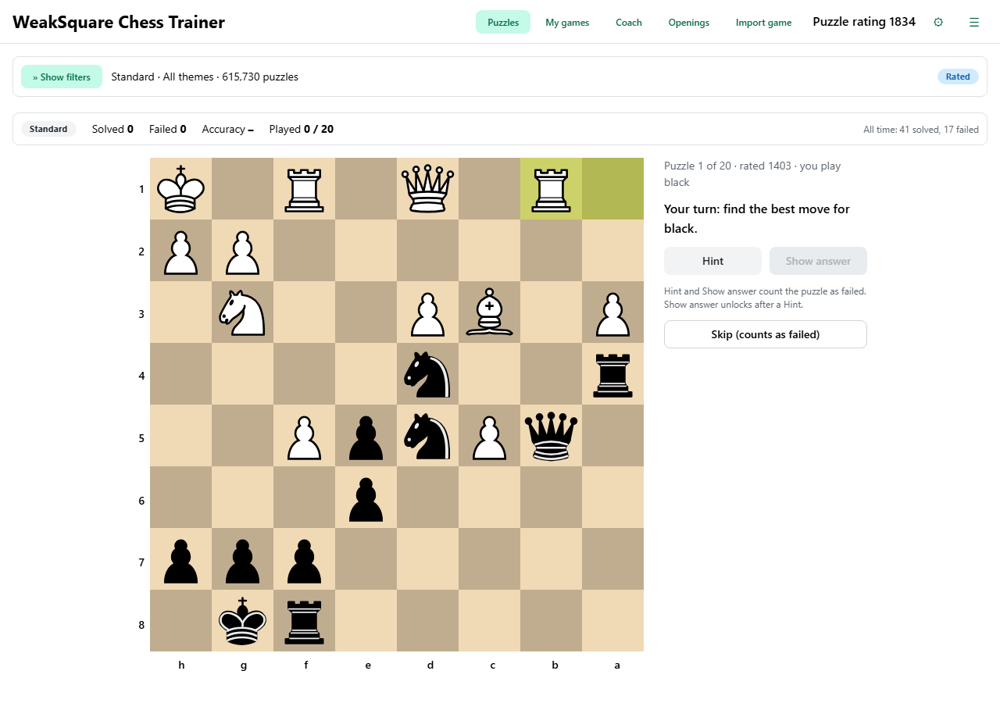

**Gotchas**
- If the count says **0 puzzles match**, Start is disabled. Widen a filter. A common cause is ALL with two themes that never appear together, such as One-move and Very long.
- Themes are hidden while you solve (see below), so choosing a single theme tells you the idea in advance. Mix several themes for a real test.
- **Exclude solved here and Exclude played on Lichess are on by default.** If a puzzle you want to repeat doesn't come up, untick them under **More filters → Your history**. When you're signed in, a puzzle you solve here also syncs to Lichess, so you need to untick both to see it again.
- With ratios, a group with no matching puzzles says **No puzzles: left out**. If you start anyway, a note says so and the other groups share its slots. If a group runs out during the session, the others fill in for it.
- **Easy → hard** and **By theme** sort the whole session when it has a fixed size. With **Endless** they sort each block of 50 puzzles, which the panel points out.
- The filters you used in v0.1 get the new defaults (quality on, Exclude solved on) once, the first time v0.2 opens. After that, your choices are kept.

## Presets
*Added in v0.2.*

A preset is a named set of filters, such as "Combo night" with a 50/30/20 ratio, that you can load in one click. Presets are saved on this PC with the rest of your data.

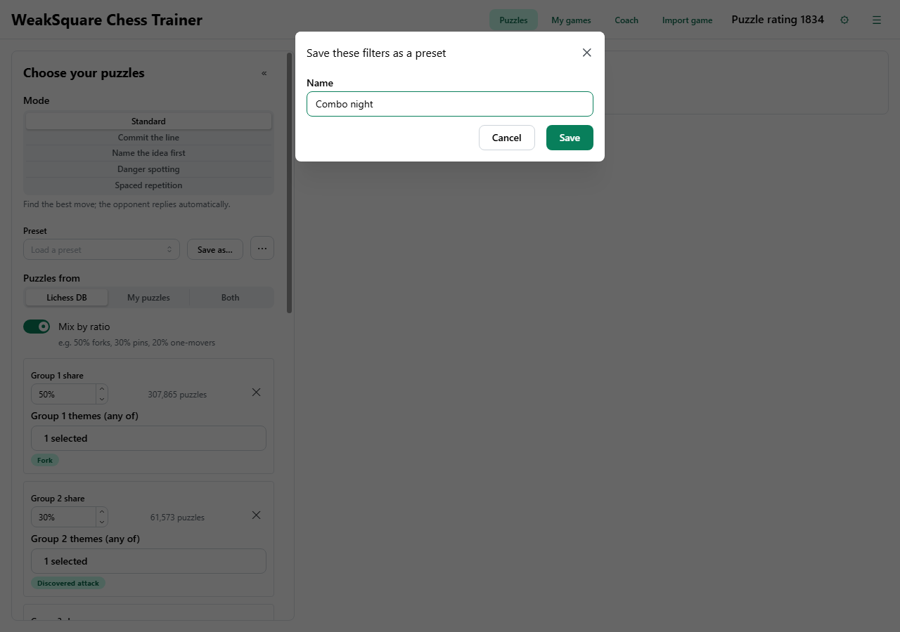

1. Set up the filters you want.
2. Click **Save as…**, type a name and click **Save**.
3. Later, choose it from **Preset** to load those filters. You can still change them before you press Start.

The **⋯** button next to it:
- **Update “<name>” with these filters** *(Changed in v0.11)*: after you've loaded a preset and changed the filters, saves your changes into it.
- **Rename…** and **Delete…** the preset you loaded.
- **Manage presets…** *(Added in v0.11)*: a list of all your presets, with when each was last saved. For any of them, **Overwrite with these filters**, **Rename** or **Delete** it, without loading it first. Managing presets never changes the filters you have now.

**Gotchas**
- Names are up to 60 characters, and two presets can't share a name, ignoring capitals. If you save under a name that exists, the app asks before replacing it with **Replace it**. The same goes for **Save as preset** in the Coach: **Replace it**, or type another name and save (v0.11).
- Loading a preset replaces all your filters. To keep your changes in it, use **Update** in the **⋯** menu.
- A preset saved by a newer version of the app may use filters this version doesn't have. It's listed as **(can't be used)**, says why, and is left untouched.

## Stats
*Added in v0.2. Changed in v0.3: the Lichess rating trend. Changed in v0.5: By mode. Changed in v0.6: mode details, Why you missed, misclicks. Changed in v0.8: Why you missed in your games, Retry and My puzzles.*

Choose **☰ → Stats** to see how you're doing across every puzzle you've played in this app.

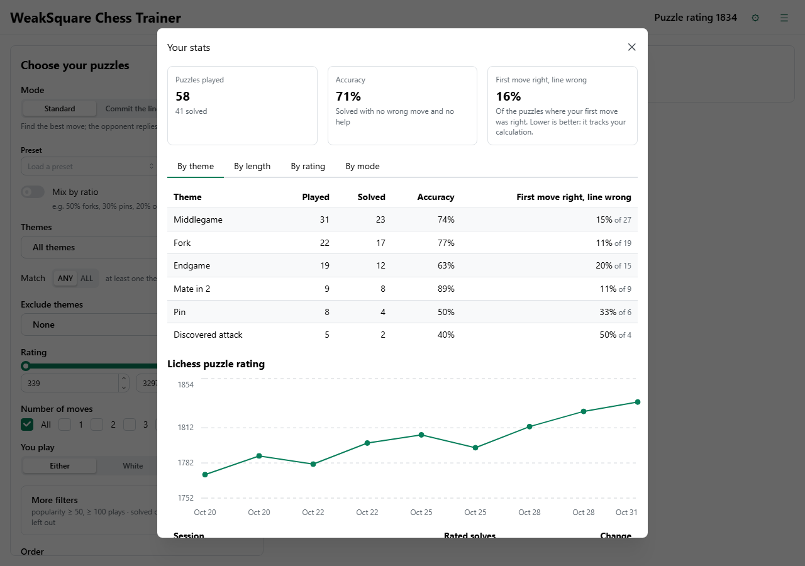

- **Puzzles played** and **Accuracy**: a puzzle counts as solved only with no wrong move and no help.
- **First move right, line wrong**: of the puzzles where your first move was right, how often the rest of the line went wrong. Spotting the idea but miscalculating the follow-up shows up here, so a falling number means your calculation is improving.
- **By theme**, **By length** (how many moves you make), **By rating** (200-point bands, using the puzzle's rating when you played it) and **By mode** (*added in v0.5*) break the same numbers down. A puzzle with several themes counts once under each.
- **Each mode's own measure** (*added in v0.6*, on the **By mode** tab):
  - **Commit the line:** calculation accuracy, the replies you predicted out of all the solutions' replies.
  - **Name the idea first:** **ideas found** (the puzzle's motifs you named, out of all its motifs) and **tags right** (your tags that were motifs, out of all your tags).
  - **Danger spotting:** how often you called a **safe** move Safe, and how often you spotted **and punished** a real blunder. Look at both: a habit of always saying "Unsafe" shows up as a low first number.
- **Why you missed** (*added in v0.6*): how often you gave each reason for a miss (see [Mistake reasons](#mistake-reasons)), with its gap type (process, calculation, knowledge, time). Pick a **Theme** or a **Mode** to see one part of your training, for example why you miss forks. *Changed in v0.8:* **From** switches between **Puzzles**, **My games (and Retry)** (the reasons you gave on your game mistakes and Retry misses) and **Both**, so you can compare why you miss things in games with why you miss them in puzzles. **By week** shows the same counts over time, as a chart and a table.
- **My games and my puzzles** (*added in v0.8*): how many of your mistakes you found in [Retry](#why-you-missed-it-save-as-puzzle-and-retry), and your accuracy on Lichess puzzles and on [My puzzles](#my-puzzles).
- **Lichess puzzle rating** (*added in v0.3*): your rating over time, one point each time Lichess reported a new rating for your synced solves, and a table of the change in each session (newest first). Hover over the line to see a point's rating. It's empty until you sign in with Lichess and sync rated puzzles. The numbers are exactly what Lichess returned.

**Gotchas**
- If a database update removes a puzzle you played, your attempt still counts in the totals and by rating, but not by theme or length. A note under the tables says how many.
- Attempts from v0.1 get their puzzle's rating filled in the first time you open Stats, where the puzzle is still in the database.
- **Misclicks don't count** (*v0.6*): a miss you tagged **Misclick** is left out of every number above, and a note says how many there are. If a lot of your tagged misses are misclicks, **Why you missed** says so.
- **Danger-spotting results count only on the By mode tab**: spotting a blunder isn't solving the puzzle, so they're left out of the totals and the other tabs.

## Solving a puzzle
*Added in v0.1. Changed in v0.2: Hint, Show answer and keyboard shortcuts.*

1. The board turns to your side and the opponent's move plays first. Then it's your turn: find the best move.
2. Drag a piece, or click it and then its destination. A click anywhere inside a square counts. When a pawn promotes, choose the piece. *Changed after v0.5:* a click only registered near a square's middle after something above the board changed height.
3. If your move is right, the opponent's reply plays automatically. Keep going until the line is complete.
4. When the puzzle ends, the result panel shows whether you **Solved** or **Failed** it, and reveals its **themes**. When you're signed in, it also shows the **Lichess rating** change (see [Your puzzle rating](#your-puzzle-rating)). **Open this puzzle on Lichess** shows it on the Lichess website.
5. Press **Next puzzle**.

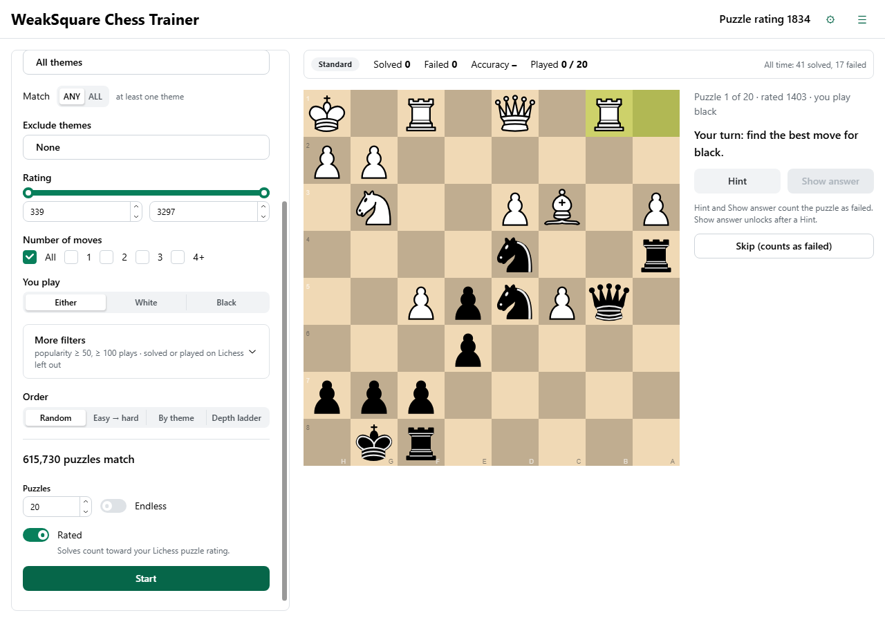

**How it's scored**
- **Solved** means you played every move of the solution with no wrong move.
- A **wrong move fails the puzzle at once**. The move is taken back and you can keep trying to finish the line, with nothing more to lose.
- When the solution is a checkmate, **any** checkmating move counts.
- Pressing **Skip (counts as failed)** before you've finished also records a failed attempt.
- Using **Hint** or **Show answer** before the puzzle is decided fails it too (see below). After it's decided, Show answer is free.

**The session bar** at the top shows this session's **Solved**, **Failed**, **Accuracy** and **Played**, and once you're signed in to Lichess, the rating change this session (e.g. **+34 this session**). Misses you tagged **Misclick** are counted apart ("1 misclick") and left out of Failed and Accuracy (*v0.6*, see [Mistake reasons](#mistake-reasons)). On the right, **All time** counts every attempt you've ever made; your attempts are saved as you go, so they survive closing the app. When a fixed-length session ends, you get a summary and a **New session** button.

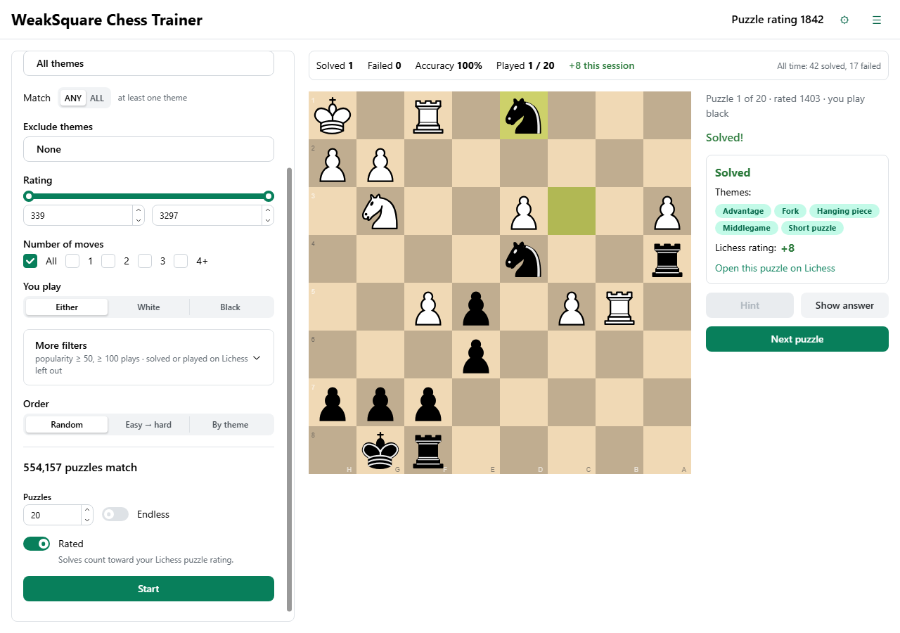

## Getting unstuck: Hint and Show answer
*Added in v0.2.*

When you can't find the move, the **Hint** and **Show answer** buttons beside the board help, one step at a time.

1. **Hint** circles the piece that moves next. You can still play the move and finish the line yourself.
2. **Show answer** unlocks once you've used a Hint. It shows the rest of the solution from where you are, one move at a time: **Forward ▶** plays the next move (yours and the opponent's replies), **◀ Back** takes it back, and the line under the board names each move. The puzzle ends there, and **Next puzzle** moves on.

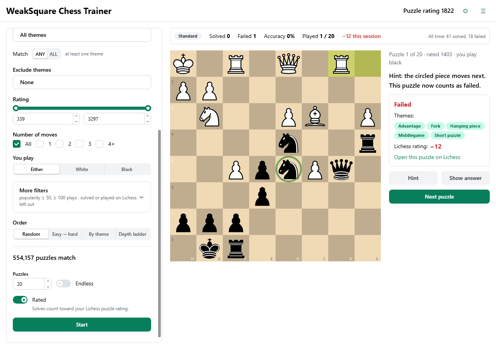

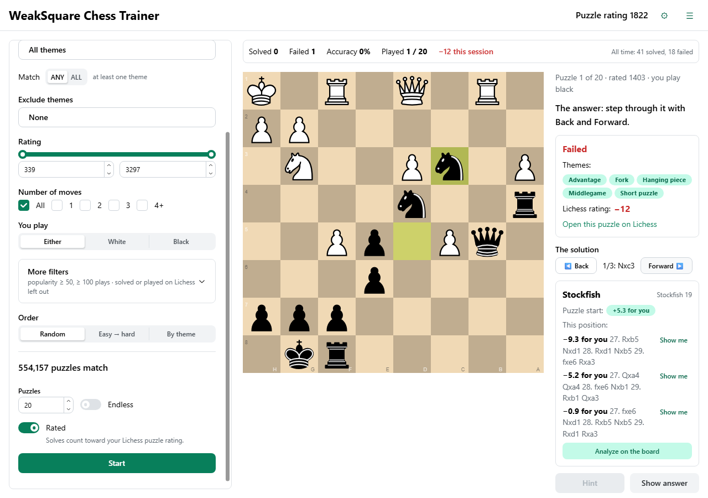

**How it's scored**
- Using either button **before the puzzle is decided fails it** (like on Lichess), and your Stats record that you needed help. The result panel shows **Failed** and the themes straight away.
- If the puzzle is already decided (a wrong move, or you finished the line), Show answer is free and doesn't need a Hint. After a solved puzzle it replays the whole solution from the start.
- *Changed in v0.4:* once the puzzle is over, **Show answer** stays clickable. Click it again any time (for example after exploring on the analysis board) to go back to the start of the answer.

### Try again (not scored)
*Added in v0.4.*

Once a puzzle is over, **Try again (not scored)** (or **R**) sets the board back to the puzzle's start so you can solve it again, with the usual right/wrong feedback and the opponent's replies. A **Practice: not scored** badge shows while you do.
- Nothing is recorded: your Stats, the session bar and Lichess keep the result of your first try.
- Hint and Show answer are free while practising.
- Stockfish stays hidden until the practice run is over, just like the first time.
- You can try again as often as you like. **Next puzzle** moves on as usual.

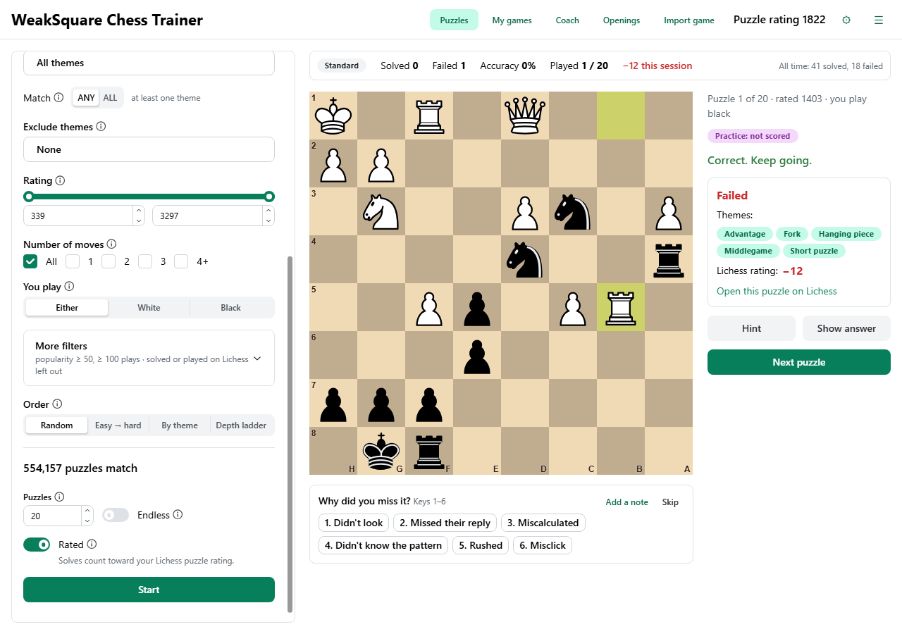
- *Changed in v0.7:* the third step is **Explain**, an AI explanation of the puzzle, once it's over. See [AI explanations and what they cost](#ai-explanations-and-what-they-cost).
- After a wrong move you can open the answer directly. *Changed in v0.4:* it then starts by showing why your wrong move fails, using Stockfish (see [Stockfish](#stockfish-why-a-move-fails-evals-and-the-analysis-board)).

## Stockfish: why a move fails, evals and the analysis board
*Added in v0.4.*

WeakSquare uses **Stockfish 19**, the free chess engine, running on your PC. It's there to help you learn from a puzzle **after** you've tried it: it never shows an evaluation, a line or a hint while a puzzle is in progress.

### Installing Stockfish
Setup installs it for you (see [Installing from source](#installing-from-source)). If it isn't installed, the places that use it show **Stockfish isn't installed** with an **Install Stockfish** button:

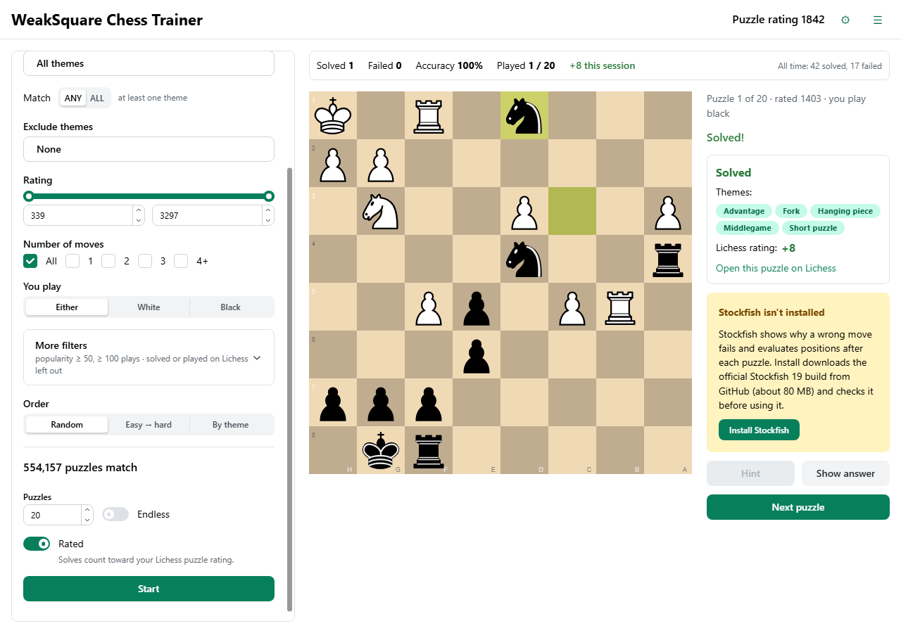

1. Click **Install Stockfish**. The app downloads the official Stockfish 19 build from GitHub (about 80 MB) and shows its progress.
2. Before using the file, the app checks it against a fingerprint (SHA-256) recorded in the app, so a damaged or altered download is refused and deleted. It then runs a short self-test.
3. When it's done, the engine panel appears. You don't need to restart.

Stockfish is stored in your data folder under `engines\sf_19`. Each data folder has its own copy.

### Why your move fails
If you play a wrong move and then click **Show answer**, the board shows **the solution** as usual, and a line above it says **Why *your move* fails**, with Stockfish's evaluation (for example "Why h6 fails: −9.3 for you"). Click its **Show me** to step through your move and Stockfish's best reply (up to 5 moves by both sides) with **Forward ▶** and **◀ Back** (or **→** and **←**); **Done** puts the solution back. *Changed in v0.4 during testing:* the answer used to start with this line; now it always starts with the correct solution.

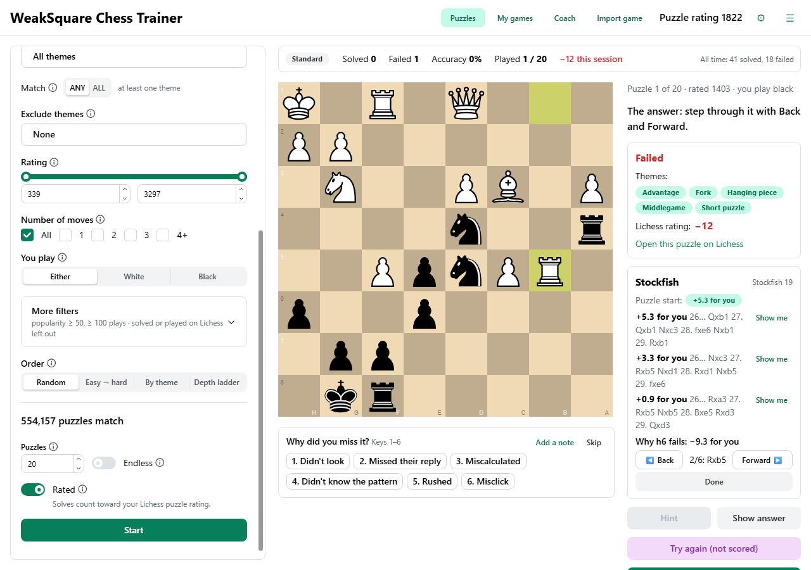

If you made several wrong moves, the first one is shown: that's the one that cost you the puzzle. If you didn't play a wrong move, Show answer goes straight to the solution.

### The engine panel
Once the puzzle is over (you finished the line, or you used Show answer), the **Stockfish** panel appears beside the board:
- **Puzzle start:** the evaluation of the position you had to solve, kept at the top.
- **This position:** the evaluation and Stockfish's **top 3 lines** for whatever is on the board. It follows you as you step through the answer.

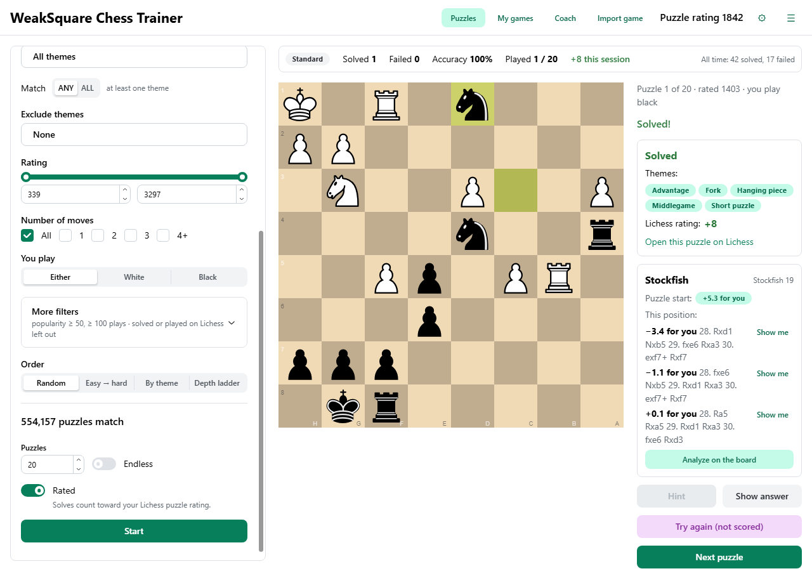

**Show me:** each line has a **Show me** button. It puts that line on the board and you step through it yourself: **Forward ▶** plays the next move, **◀ Back** takes it back (or use **→** and **←**). Nothing moves until you step, and you can't move pieces while a line is showing. **Done** puts the board back where you were. The panel keeps showing the lines for that position meanwhile. It works on the analysis board too.

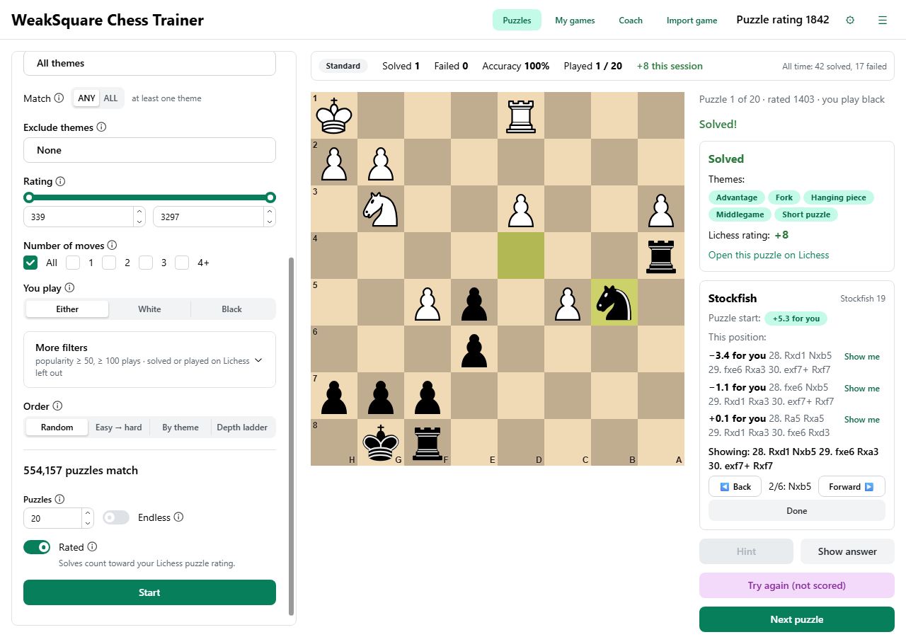

**Reading the evaluation.** Evaluations are always from **your side** (the side you played in the puzzle):

| You see | It means |
|---|---|
| **+3.2 for you** | You're ahead by about three pawns' worth. |
| **−1.4 for you** | You're behind by about one and a half pawns. |
| **0.0 (level)** | Neither side is better. |
| **You mate in 3** / **You're mated in 2** | A forced checkmate, in that many of the mating side's moves. |

### The analysis board
Click **Analyze on the board** in the panel to play out your own ideas. You can move pieces for **either side** (legal moves only), and after each move Stockfish re-evaluates and draws an arrow for its best move. **◀ Back** and **Forward ▶** step through your moves, **Reset** goes back to the puzzle position, and **Close** returns to the puzzle. If you opened the answer first, the button reads **Back to the answer** and takes you back to it (so does **Show answer**). Nothing you do on the analysis board is scored or saved.

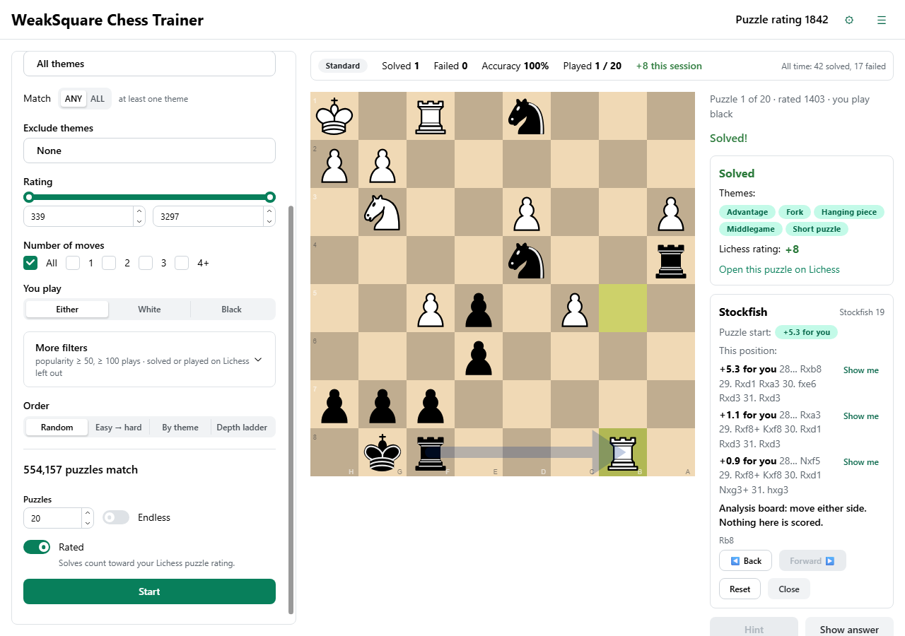

### Engine settings
In **⚙ Settings → Engine**:

| Setting | What it does |
|---|---|
| **Think time (s)** | How long Stockfish thinks about each position. 1 second by default, from 0.2 to 10. Longer is a little stronger and keeps the CPU busy for longer. |
| **Threads** | How many processor cores it may use. By default all but one, so the app stays responsive. |
| **Hash (MB)** | Memory for the engine's working tables. 256 MB by default, from 16 to 2048. |
| **Use my own engine…** | Pick another UCI engine's `.exe` (for example a Stockfish build you prefer). It's used only if it passes the same self-test. **Use the managed Stockfish** switches back. |
| **Reinstall** | Downloads and checks the pinned Stockfish again. |

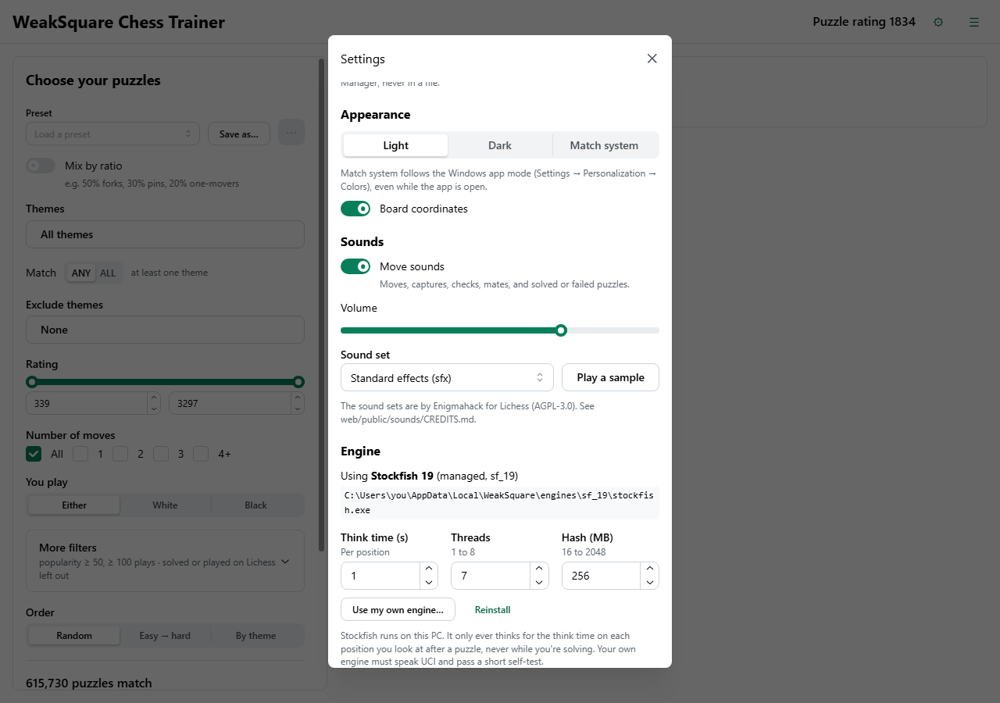

**Gotchas**
- Stockfish only thinks when you look at a position after a puzzle (about one think time per position), so it doesn't use the CPU while you solve. Stepping quickly through a line asks about the newest position only.
- If Stockfish ever stops unexpectedly, the app restarts it and says so. Try again.
- If your own engine can't be found any more (the file was moved or deleted), the app says so and offers **Use the managed Stockfish**.

## Training modes
*Added in v0.5. Changed in v0.6: Name the idea first and Danger spotting.*

The **Mode** control at the top of the filters panel picks how you train. Your choice is remembered next time.

| Mode | What it's for |
|---|---|
| **Standard** | The usual way: find the best move, the opponent replies automatically, and a wrong move is flagged at once. |
| **Commit the line** | Calculation practice: you work out the whole line in your head, enter it on the board, and only then find out if it was right. |
| **Name the idea first** | Pattern recognition: say what the idea is before you play it (*added in v0.6*). |
| **Danger spotting** | Blunder-checking: is the move about to be played safe, and if not, how do you punish it? (*added in v0.6*) |
| **Spaced repetition** | Puzzles you missed come back on their review day until you've learned them. |

**Switching modes while a session is running starts a new session** in the new mode, with your current filters and Rated setting, just like pressing Start. The puzzle you were on is left unfinished and isn't recorded. If the new session can't start (for example, nothing is due for Spaced repetition), the app says why and your current session and mode carry on.

### Commit the line
1. Choose **Commit the line**, then press **Start**. The opponent's first move plays as usual.
2. Enter the whole line on the board: your move, the reply you expect, your next move, and so on. You move **both sides**. Nothing is checked and nothing replies for you; the board only refuses illegal moves.
3. **Undo** takes back the last move you entered; **Clear** takes them all back.
4. When you think the line is complete, press **Submit**.

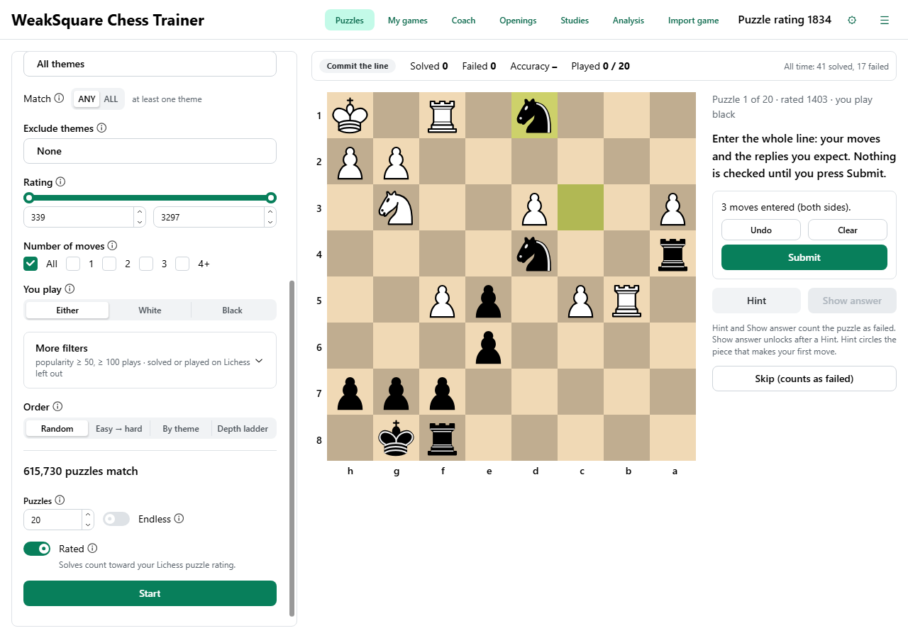

After Submit, **Your line** lists every move with ✓ or ✗ and, where yours was wrong, the solution's move. Everything else is as in Standard: the themes, the rating change, **Show answer**, Stockfish and **Try again**.

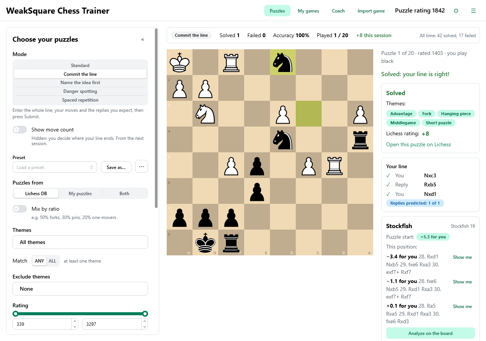

**How it's scored**
- **Solved** means every one of *your* moves matches the solution. As in Standard, any checkmating move counts where the solution mates.
- The replies you predicted don't affect that. They're scored separately as **Replies predicted: 2 of 3**, your calculation accuracy.
- **You decide where the line ends.** If you stop before the end of the solution, your missing moves count as wrong. Moves you enter after the end of the solution are ignored.
- Hint (it circles the piece that makes your first move) and Show answer count the puzzle as failed before you submit, as in Standard. After you submit they're free.

**Show move count** (under the Mode control, this mode only, off by default) tells you how many moves the solution has, "Find 3 moves (both sides)", and stops you entering more. It applies from the next session you start. With it off, you can enter up to 60 moves, whatever the puzzle.

**Gotchas**
- With **Show move count** on, Lichess counts your solves for less. Lichess weighs a solve by what you knew in advance, and knowing the length is a hint, so the app reports it truthfully (see [Your puzzle rating](#your-puzzle-rating)). With it off, solves count as they do in Standard.
- A wrong prediction doesn't cost you the puzzle, but the moves you entered after it were played on *your* board, not the real one. The app still compares them with the solution's moves one by one.
- Stockfish's **Why your move fails** only appears when your first wrong move was played in the real position, that is, when every move before it matched the solution.

### Name the idea first
*Added in v0.6.* Before you touch a piece, you say what the tactic is. Naming it first trains you to recognise the pattern, not just to find a move that works.

1. Choose **Name the idea first**, then press **Start**. The opponent's first move plays as usual, and the board waits.
2. Under **Name the idea**, pick up to three **Setup** motifs (how you get there, for example Deflection or Attraction) and up to three **Payoff** motifs (what it wins, for example a Fork, a Pin or a mate pattern). You need at least one tag.
3. Press **Start solving** and solve the puzzle as in Standard.

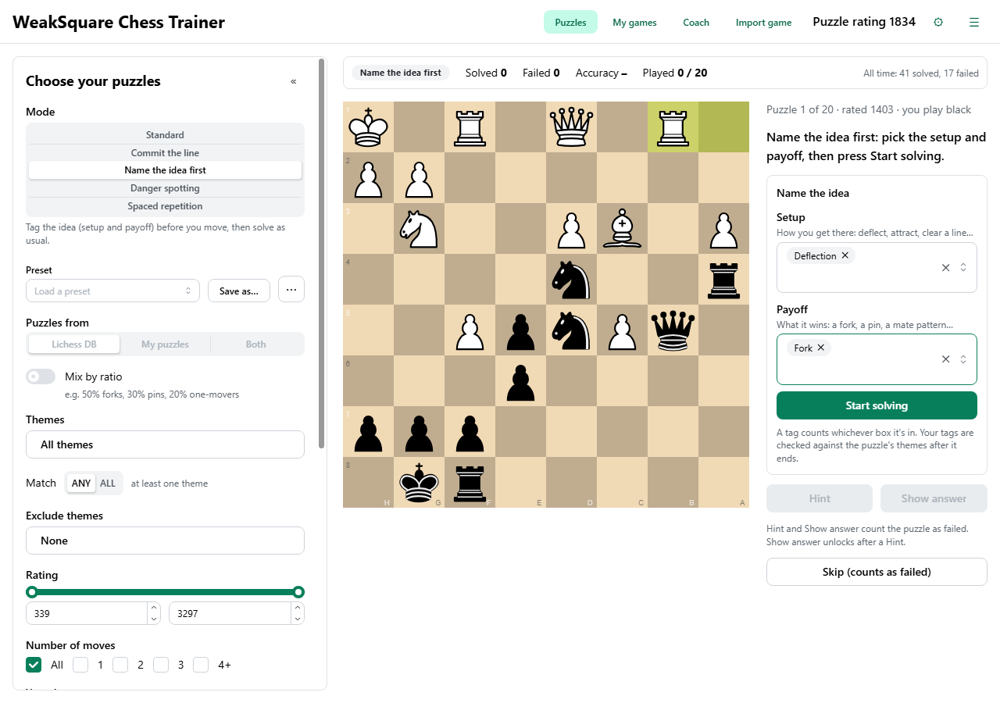

When the puzzle ends you see **Ideas found 1 of 2 · 1 extra**: each of your tags with ✓ (it was one of the puzzle's motifs) or ✗ (it wasn't), and the motifs you missed.

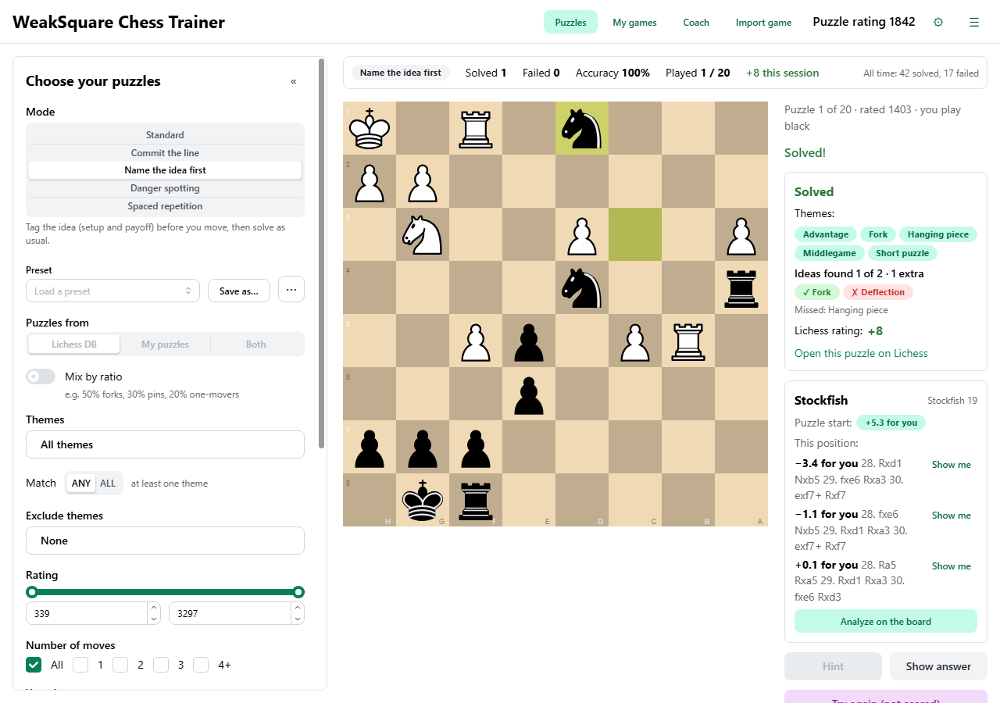

- Solving is scored exactly as in Standard: your tags don't decide whether you solved the puzzle, and they're scored separately (see [Stats](#stats)).
- **A tag counts whichever box it's in.** The Setup/Payoff split is there to help you think: Lichess doesn't record which role a theme plays in a puzzle.
- Your tags are compared with the puzzle's **motif** themes only (motifs, advanced tactics, mate patterns and special moves), not with phases, goals or lengths. A puzzle with none of those has no tag score.
- Solves sync to Lichess as in Standard. **Try again** skips the tagging.

### Danger spotting
*Added in v0.6.* Most lost games turn on a move that looked fine. Danger spotting shows you the position **just before** a blunder, from the side that's about to play, with one move highlighted by an arrow.

1. Choose **Danger spotting**, then press **Start**. It needs Stockfish (see [Installing Stockfish](#installing-stockfish)); without it, the panel offers the install and **Start** is greyed out.
2. Decide whether the highlighted move is safe, then press **Safe** (or **S**) or **Unsafe** (or **U**).
3. If you say **Unsafe** and it really is the blunder, it's played and the board turns round: now find the move that punishes it, for the other side. One move is enough.

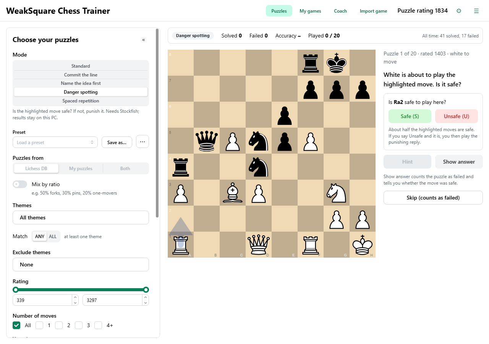

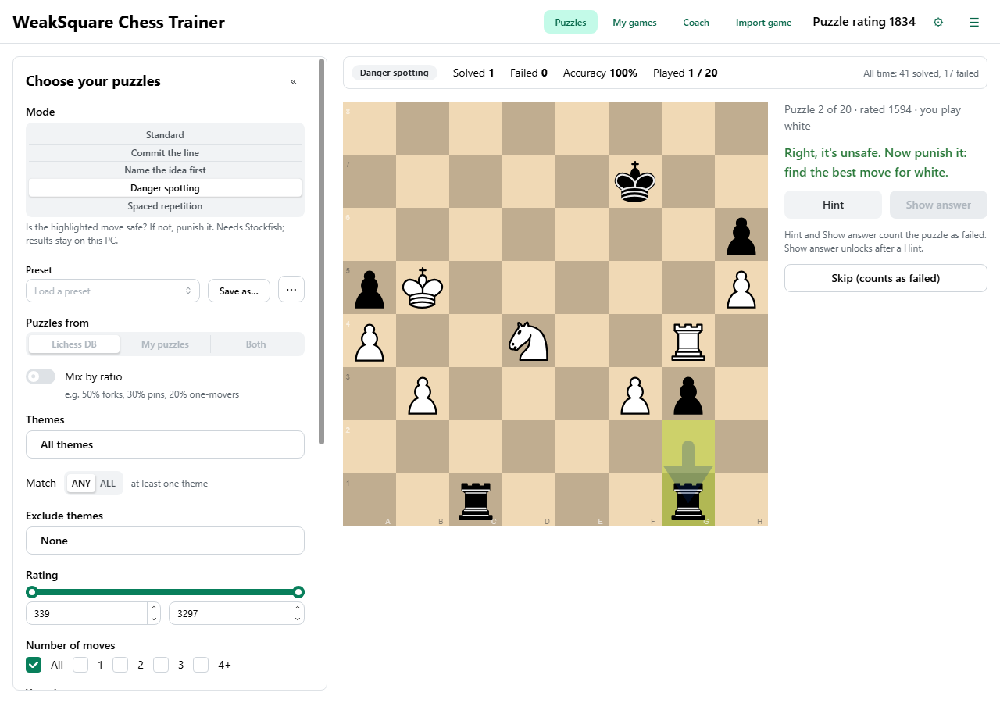

**How it's scored**
- **Safe** on a safe move is solved. **Unsafe** on the blunder, followed by the right punishing move (any mate counts where the solution mates), is solved.
- Calling a safe move Unsafe, calling the blunder Safe, or not finding the punishment is a miss.
- After the end, the result says which it was: a safe move with Stockfish's evaluation of it and of its best line, or the game's blunder and the move that punishes it. **Show answer** steps through the whole line.

**Gotchas**
- **About half the highlighted moves are safe.** The safe ones are checked by Stockfish when the puzzle loads: a move counts as safe if it's at most half a pawn worse than Stockfish's best move and doesn't allow a mate. Stockfish looks at every position before it appears, safe or not, so each puzzle takes about your engine think time to show ("Preparing the position…") and the wait never gives the answer away.
- Before your call there's no Hint (it would give the answer away). **Show answer** before your call counts as a miss and tells you whether the move was safe.
- **Results stay on this PC.** Nothing is sent to Lichess, so the **Rated** switch is greyed out. Danger-spotting results don't put puzzles into Spaced repetition and don't count for *Exclude solved here* or *Only my misses*.
- The depth ladder isn't available in this mode or in Name the idea first.

### Spaced repetition
Every puzzle you fail, in any mode except Danger spotting, goes into the first of five review boxes. That includes the puzzles you failed before v0.5. A puzzle in box 1 comes back the next day. Each time you solve it in **Spaced repetition** it moves up a box and waits longer: 1, 3, 7, 14, then 30 days. Solving it from the last box retires it. Failing it again, anywhere, puts it back in box 1.

1. Choose **Spaced repetition**. The panel shows how many puzzles are due now and when the next one is.
2. Press **Start**. You get the puzzles that are due, the most overdue first, and solve them as in Standard.

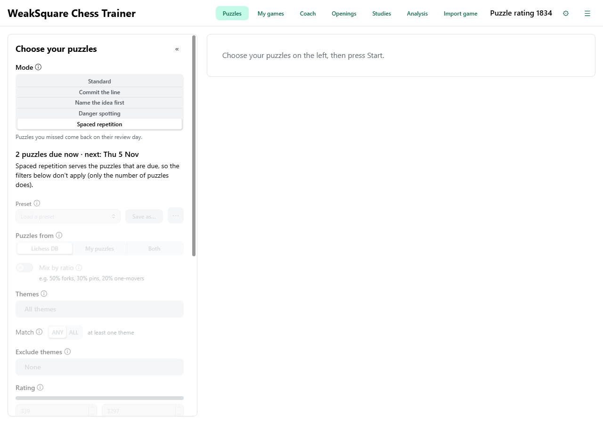

- **The filters don't apply** in this mode, so they're greyed out. Only the number of puzzles does.
- When nothing is due, **Start** is greyed out until the next review day.
- Review days are calendar days: a puzzle you miss in the evening is due the next morning.
- Solving a puzzle in another mode doesn't move it up a box. Only reviews here do.
- These puzzles are usually ones Lichess has already seen from you, so they show **Already played: rating unaffected**. Lichess doesn't rate a puzzle twice.
- You can change the boxes under **Settings → Training** (see [Training settings](#training-settings)).
- A miss you tag **Misclick** (see [Mistake reasons](#mistake-reasons)) still comes back here: replaying it costs nothing.

### Depth ladder
The depth ladder is an **Order** choice (**Choose your puzzles → Order → Depth ladder**), and it works in Standard and in Commit the line. It trains you to calculate deeper, one step at a time:

1. You start on **short** puzzles (2 moves of yours).
2. Once you've solved at least 80% of your last 20 at that level, you move up to **long** puzzles (3 moves), then **very long** ones (4 or more).

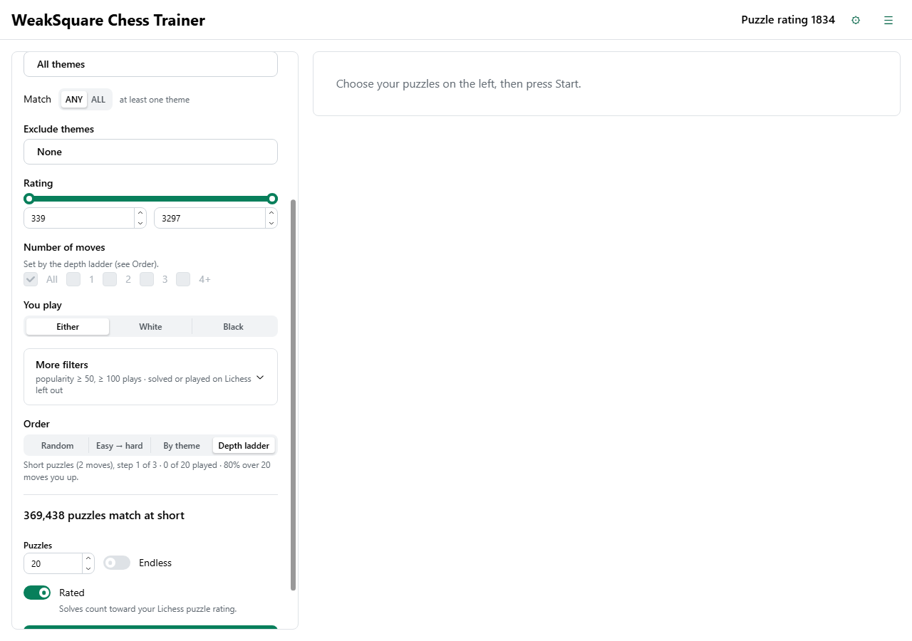

- Under **Order**, a line shows your level and how you're doing, for example "Short puzzles (2 moves), step 1 of 3 · 14 of 20 played, 79%". The session bar shows the same while you play, and **Level up!** appears on the result when you move up. The session carries on at the new level.
- Your level is kept for each set of themes you choose (with **All themes** as a set of its own), so it carries over to your next session. **It never goes back down.**
- A level with no puzzles for your filters is skipped. Mate in 2, for example, only has 2-move puzzles, so for it Short is already the top of the ladder.
- The ladder sets **Number of moves** itself, so that control is greyed out. It can't be combined with **Mix by ratio**.
- Because you know the length in advance, Lichess counts these solves like a themed session: for the theme that matched, or the length (Short / Long / Very long) when you chose All themes.
- You can change the 80% and the 20 under **Settings → Training**. Try again (practice) runs don't count, and neither do misses you tag **Misclick** (v0.6).

### Training settings
*Added in v0.5. Changed in v0.6: the mistake-reason settings.* Under **⚙ → Settings → Training**:

| Setting | What it does |
|---|---|
| **Move up at (%)** / **Over the last (puzzles)** | The depth ladder's threshold (80% by default, 10–100) and how many recent puzzles at your level it looks at (20 by default, 3–100). Saved when you leave the box. |
| **Review boxes (days)** | Spaced repetition's boxes, as days separated by commas (1, 3, 7, 14, 30 by default). 2 to 10 boxes, each longer than the one before, up to 365 days. Press **Save**. |
| **Ask why you missed** | *Changed in v0.8.* **Always** (the default) shows the [mistake-reason](#mistake-reasons) chips after each failed puzzle and on your mistakes in Game Review; **Game Review only** asks only there; **Off** never asks. |
| **Suggest Rushed under (seconds)** | *v0.6.* A deciding move made faster than this (3 s by default, 1–30) gets **Rushed** suggested. Saved when you leave the box. |

Changing either setting applies to everything you've already played: the app works your boxes and ladder levels out from your attempt history, rather than storing them separately.

## Mistake reasons
*Added in v0.6.*

Themes say *what* you missed; a reason says *why*. Telling "I didn't know this pattern" apart from "I knew it but didn't look" matters, because they need different training: the first needs more puzzles of that theme, the second needs a slower, more careful habit.

After a failed puzzle, once it's over, a row of six chips appears below the board:

| Key | Reason | Gap |
|---|---|---|
| **1** | Didn't look for it | process |
| **2** | Missed their reply / defense / threat | process |
| **3** | Saw the idea, calculated it wrong | calculation |
| **4** | Didn't know this pattern | knowledge |
| **5** | Rushed / time pressure | time |
| **6** | Misclick | noise |

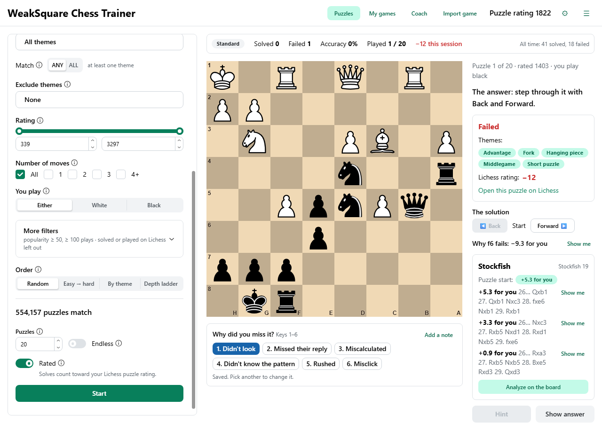

1. Click a chip, or press its number. It's saved at once ("Saved").
2. Optionally, **Add a note** (up to 200 characters) and **Save note**.
3. Changed your mind? Pick another chip: the latest one counts, and it keeps the note you wrote. **Skip** hides the chips. You can always just go to the next puzzle.

**The suggested reason**
The app highlights a likely reason with **Suggested**, but it's only saved if you click it:
- **Rushed**: your deciding move came in under 3 seconds (change this in [Training settings](#training-settings)).
- **Miscalculated**: your first move was right and a later one was wrong.
- **Missed their reply**: Stockfish's answer to your move is a check, a capture or a mate (only with Stockfish installed), or, in Danger spotting, you called the real blunder Safe.
- **Didn't know this pattern**: in Name the idea first, none of your tags was one of the puzzle's motifs.

**Misclicks**
A miss you tag **Misclick** is left out of your accuracy here: the session bar ("1 misclick"), Stats and the depth ladder. It still counts as a loss on Lichess, because Lichess has no take-backs, and it still comes back in Spaced repetition. If a lot of your misses are misclicks, Stats says so: that's worth a look.

**Gotchas**
- You're asked after every miss in every mode, including Danger spotting, but not during **Try again** practice. The chips stay while you practise.
- To stop being asked, set **Ask why you missed** to **Off** in Settings → Training. **Game Review only** keeps the question for your game mistakes and stops it after puzzles.
- Your reasons and notes stay on this PC.

## AI explanations and what they cost
*Added in v0.7.*

**Explain** asks an AI model (Anthropic's Claude or OpenAI's GPT) to explain the puzzle in plain words: the idea, why each move works, and, if you went wrong, why your move failed. The model isn't left to work out the chess on its own: the app sends it the solution, Stockfish's lines and the attack and defence facts on the key squares, then checks every move and square in the answer against the real position before showing it.

It's optional and **you pay the provider directly** with your own API key. One Explain costs about a tenth of a cent with the cheapest models, and the app's budget and per-run cap keep the spending in check.

### Setting it up
1. Create an API key in your provider's console: console.anthropic.com (keys start with `sk-ant-`) or platform.openai.com (keys start with `sk-`).
2. Open **⚙ Settings → AI explanations** (or **Show all options** on the startup page).
3. Choose the **AI provider**.
4. Pick a **Model**. Nothing is chosen for you. The list shows the models in the price table with about what one Explain costs. You can also type another model ID, but it needs a row in the price table before Explain will use it.
5. Paste the key and click **Save key**. It goes into Windows Credential Manager and the field empties: the app never shows it again. **Remove key** deletes it.
6. Click **Test key**. This asks the provider whether your key can use that model. It's free.

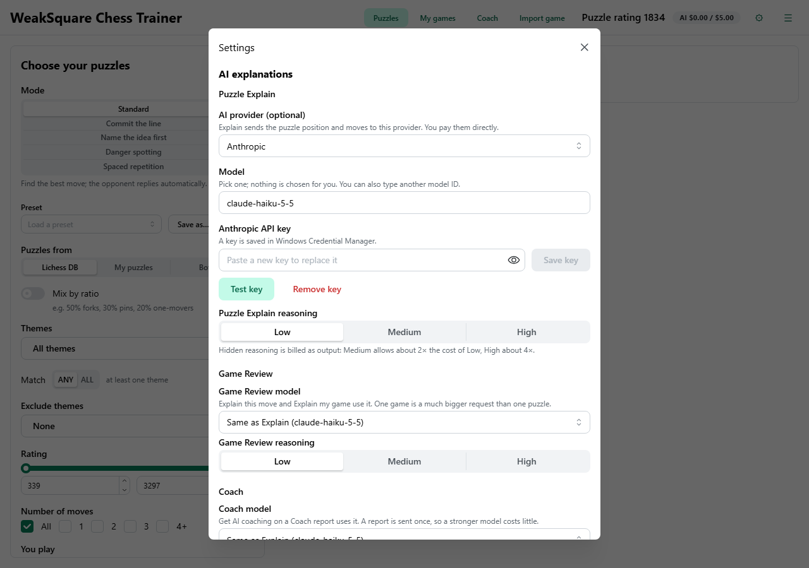

### Using Explain
Once a puzzle is over (you finished the line, or used **Show answer**), the **Explain** button below Hint and Show answer shows the estimated cost, for example **Explain (≈ $0.0012)**.
- Click it. After a few seconds the explanation appears: a summary, the key ideas, and a note for each move of the solution.
- **Show me** steps through the solution on the board (**◀ Back** / **Forward ▶**, or ← / →), drawing the explanation's arrows and circles for each move, with its note underneath. It starts by itself when the explanation arrives. **Done** puts the board back.
- If the explanation mentions a square or move that doesn't fit the position, it's left out, and the panel says *Some annotations were discarded*.
- The model's text is shown exactly as written, as plain text.

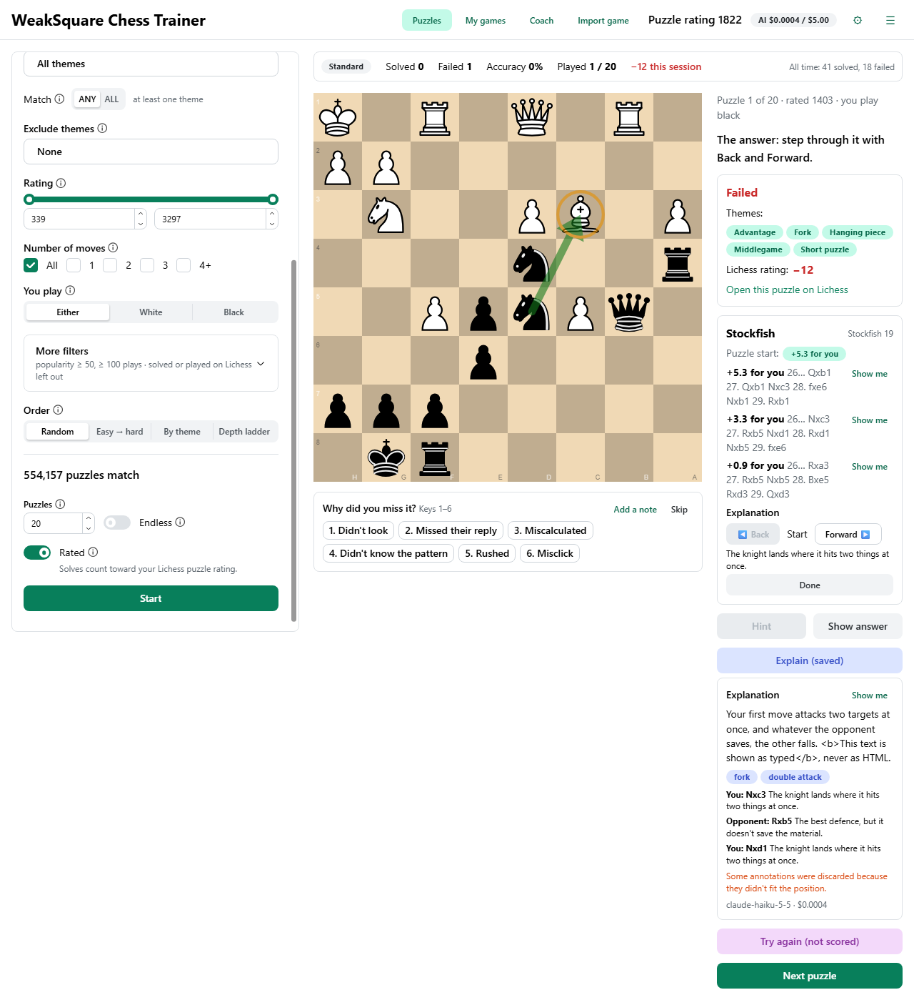

**Gotchas**
- Explain needs **Stockfish** (see [Installing Stockfish](#installing-stockfish)): without it the button stays off.
- It's only offered **once the puzzle is over**, so it never costs you a puzzle you could still solve. Using it after Show answer changes nothing: the puzzle was already failed.
- It works in every training mode. In Danger spotting it also explains why the highlighted move was safe, or why it was the blunder.
- **Saved explanations are free.** The same puzzle, with the same moves from you and the same model, shows **Explain (saved)** and costs nothing, even when this month's budget is used up. A different model gets its own explanation, so you can compare two.
- If the answer comes back cut short, refused, or not in the expected form, nothing is shown and you can try again. A cut-short or refused answer is still billed by the provider, and it counts in your spend.

### A model for each feature
*Added in v0.9.*

Puzzle Explain and [Game Review's AI](#ai-explanations-in-game-review) each have their own model. You can use a cheap, fast model for the many small puzzle explanations and a stronger one for the few, much bigger game explanations.
- **Puzzle Explain** uses the provider and model described above.
- **Coach model** (v0.10): set the same way, for [AI coaching](#ai-coaching-optional) on Coach reports.
- **Game Review model:** **Same as Explain** (the default) uses whatever Explain uses. Or pick any model in the price table, from either provider. The list shows about what one **Explain my game** costs on each. To use a model that isn't listed, type its ID and choose **Use “…” with Anthropic** or **with OpenAI**. Like Explain's model, it needs a row in the price table before it can be used. Game Review can be set up even when puzzle Explain has no provider. The same setting is on the startup page (**Show all options**), in Settings, and on the Review page next to **Explain my game**.
- **Keys are per provider, not per feature.** If Game Review uses a provider that has no key yet, a key field appears under its model.
- **Reasoning** is set per feature: **Puzzle Explain reasoning** and **Game Review reasoning**.
- **Shared by every feature:** your keys, the price table, the per-run cap and the monthly budget. Under the budget, Settings shows this month's spend for each feature.

### What it costs, and the limits
*Changed in v0.9: the limits cover Game Review too.*

Every cost comes from the **price table** and the token counts the provider reports.
- **Spend indicator:** while an AI provider is set up, the top bar shows this month's spend against your budget, for example **AI $0.03 / $5.00**. It turns yellow at 80% of the budget and red at 100%. Click it to open the settings.
- **Monthly budget** (default **$5.00**): when this month's spend reaches it, Explain and Game Review's AI are off until the next calendar month, or until you raise the budget. A request that starts just under the budget can take you a little over it.
- **Per-run cap** (default **$0.50**): a request that *could* cost more than this, if the model used every token it's allowed, is blocked. It's there to catch an expensive model or a typo in the price table.
- **Reasoning** (**Low** by default, **Medium** or **High**, set per feature): how hard the model thinks before answering. Its thinking is billed as output, so Medium allows about twice the cost of Low and High about four times. The estimate and the cap allow for it.
- **The price table** (at the bottom of **Settings → AI explanations**): USD per million input and output tokens for each model, plus the long-prompt tier for models that charge more for very long prompts. It starts with prices checked in October 2026. Prices change, so check them against your provider's pricing page. **Edit** fills the form with a row, **Save price** adds or replaces it, **Delete** removes it. Rows you change stay as you left them.

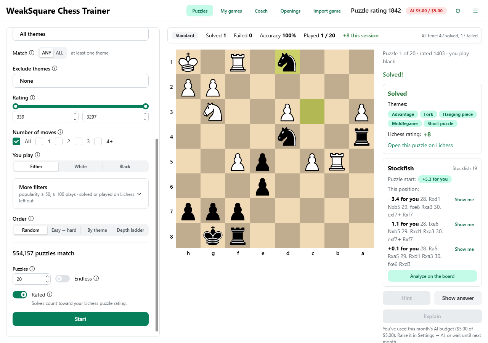

When Explain can't run, the reason shows under the button: no provider or key, no model picked, the model isn't in the price table, the per-run cap, or the monthly budget.

## Your games and Game Review
*Added in v0.8.*

Stockfish goes through your own games on your PC, for free. It grades every move, finds the moments that cost you, and shows what you should have played. You can replay those moments as practice and save them as puzzles.

### Linking your accounts
- **Lichess** is linked automatically when you're [signed in](#signing-in-with-lichess-syncing-solves-offline-mode).
- **chess.com** is linked by username. Open **☰ → Settings… → Games**, type your username (or paste your profile link), press **Verify** to check it exists, then **Link**. chess.com's public API needs no login, so linking only tells the app whose public games to fetch.

### My games
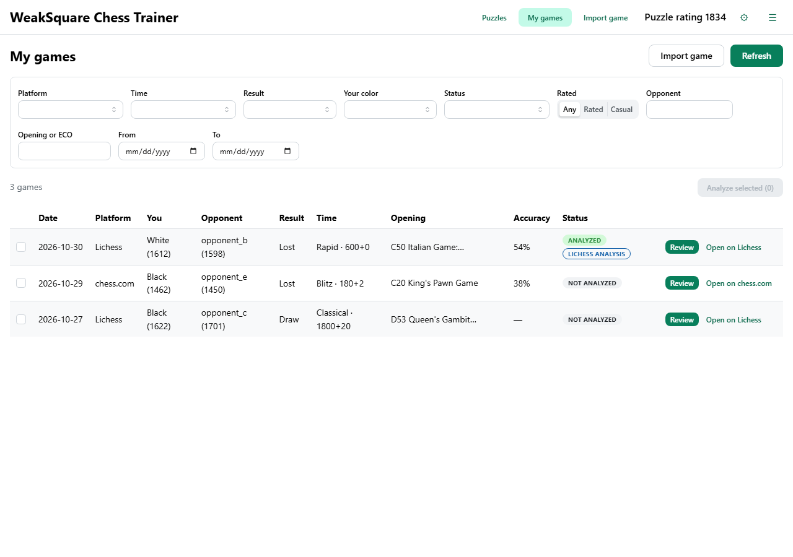

Press **My games** at the top of the window. The list combines both accounts, newest first. It shows the date, platform, your color and rating, your opponent and their rating, the result, the time control, the opening, the platform's accuracy (when it has one), and its status: **Not analyzed**, **Analyzed**, or **AI-reviewed** (from v0.9: Explain my game has run on it). **Lichess analysis** means Lichess already analyzed the game. The app still analyzes every game itself, so all your games are graded the same way.

- **Refresh** fetches your new games in the background. With **Sync new games when the app opens** on (the default), this also happens at each start. The first sync fetches the last 90 days or 200 games per account, whichever is smaller. You can change both in Settings → Games.
- **Filters** above the list: platform, time control, result, your color, status, rated or casual, opponent, opening or ECO code, and a date range.
- **Analyze selected** queues the ticked games for Stockfish. Games are analyzed one at a time, with a progress bar and **Cancel**. A game already analyzed at the same settings isn't analyzed again.
- **Review** opens a game. **Review + Explain my game** (v0.9, shown once an AI model is set up) opens it, analyzes it first if needed, then asks you to confirm [Explain my game](#ai-explanations-in-game-review). **Open on Lichess / Open on chess.com** opens it in your browser.

### Importing one game
Press **Import game** (at the top, or on My games):
- **Paste PGN:** paste a game's PGN and press **Import**.
- **PGN file:** choose a `.pgn` file. If it holds several games, pick one from the list. Games that can't be read are shown with the reason.
- **Game URL:** a `lichess.org/…` or `chess.com/game/live/…` link. chess.com has no single-game lookup, so the app searches the last six months of your chess.com games. If you haven't linked a username, it asks for it. If the game isn't found, paste its PGN instead (on chess.com: **Share → PGN**).

If the app can't tell which side you played, it asks: **White**, **Black** or **Review both sides**. Only standard chess can be imported, not Chess960 or other variants. Importing a game you already have (the same game, or the same moves) opens the existing one, with its analysis.

### Reading the review
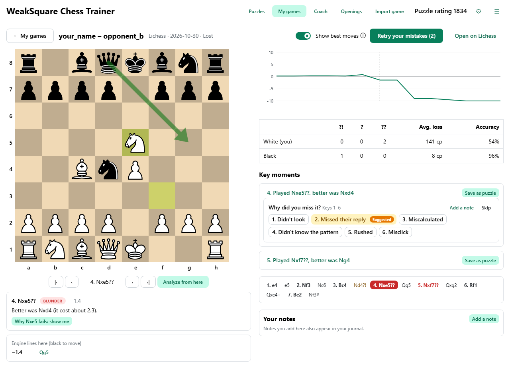

- **The board and the move list.** Step with the arrows below the board (or the **←** and **→** keys), or click a move. Your moves are in bold. The symbols mark inaccuracies (**?!**), mistakes (**?**) and blunders (**??**). A move isn't penalized when the game was already lost before it (−5 or worse), or is still won after it (+5 or better). Dropping from +8 to +1 still counts.
- **The eval graph** shows who was better through the game, from White's side and capped at ±10. Click it to jump to a move.
- **The summary** gives each side's inaccuracies, mistakes, blunders, average loss and the platform's accuracy.
- **At any move,** with **Show best moves** on, a green arrow shows Stockfish's best move, and **Engine lines here** lists its top three lines. Click a line to step through it. After a bad move, **Why … fails: show me** steps through the punishment.
- **Key moments** are your biggest mistakes (five by default). Each one reads *Played X*, and with **Show best moves** on, *better was Y*. Click it to go there.

### Show best moves and Analyze from here
*Added in v0.10.*

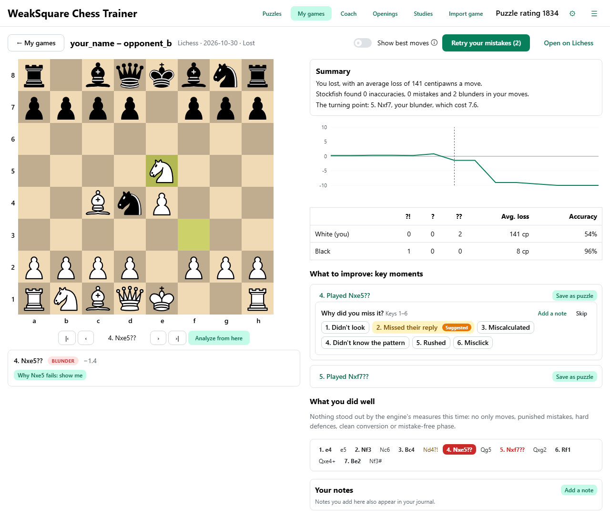

**Show best moves** is a switch at the top of the review. It's **off** at first, so you can look for the better move yourself before the engine tells you. The app remembers your choice for every game and the next time you open it.
- **Off hides** the best-move arrow, **Engine lines here**, *Better was …* under a move, *better was …* on the key moments, the arrows and better lines from **Show me** and **Show on the board** in the AI's notes, the step-by-step line of **Explain this move** (its summary stays), and Stockfish's panel in Analyze from here.
- **Off still shows** the eval graph and the eval of each move, the **?!**, **?** and **??** symbols, **Why … fails: show me**, and the AI's text.
- Turn it on and everything appears at once. Retry mode works the same either way.

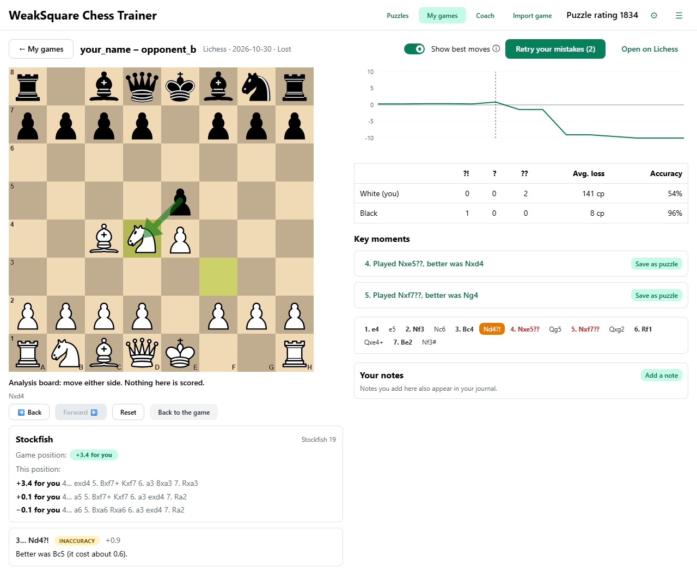

**Analyze from here** (under the board) opens a free board at the position on screen. Move pieces for either side to try your own ideas.
1. Play moves on the board. **◀ Back** and **Forward ▶** (or **←** and **→**) step through what you played; **Reset** goes back to the game position.
2. With **Show best moves** on, Stockfish's eval and top three lines follow the position on the board, with a green arrow for its best move. With it off, they stay hidden until you turn it on.
3. **Back to the game** returns to the game where you left it.

Nothing you play there changes the game, its analysis or your stats. It uses the same engine as the analysis board after puzzles, so it answers even while games are being analyzed in the background.

### Why you missed it, Save as puzzle and Retry
- **Mistake reasons:** open a key moment and pick why it happened with the [reason chips](#mistake-reasons) (keys **1–6**). Settings → Training → **Ask why you missed** controls this. **Game Review only** asks here but not after puzzles.
- **Save as puzzle** turns the position before your mistake into one of [My puzzles](#my-puzzles), with Stockfish's best line as the answer (at most three of your moves). From v0.10 it's also tagged with Lichess's themes, which stay hidden until you've solved it. You don't need to save every mistake by hand: the analysis [makes puzzles from your mistakes](#puzzles-from-your-games) by itself.
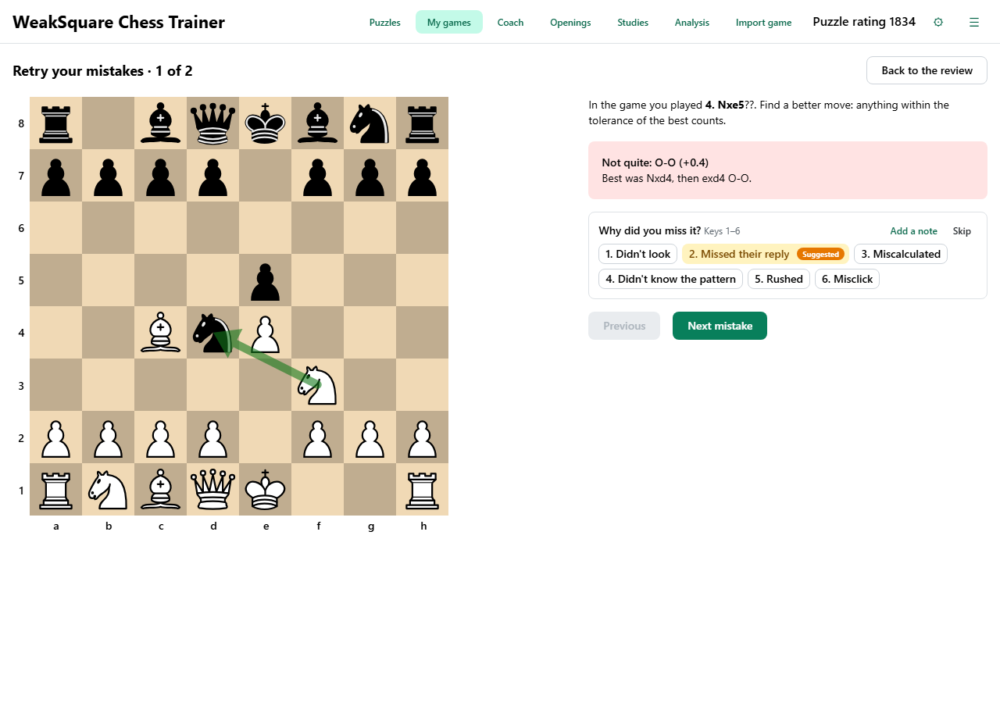

- **Retry your mistakes** goes through your mistakes and blunders one by one, without showing the answer. Play the move you should have played. Any move within 30 centipawns of the best counts as found (Settings → Games → **Retry tolerance**). Then you see the best line and, if you missed, what your move ran into. Retries count in Stats only. They never go to Lichess, and nothing in Game Review affects a rating.
  - *Changed in v0.11:* once you've tried, **Explain this move** is there too (with an [AI provider set up](#setting-it-up)): the same explanation as in the review, with **Show me** drawing on the Retry board. It's never offered before you try, so it can't give the move away.

### AI explanations in Game Review
*Added in v0.9.*

With an [AI provider set up](#setting-it-up), Game Review can explain your games in words. The AI works from Stockfish's analysis, so the game must be analyzed first. As with puzzle Explain, every move and square in its answer is checked against the game before it's shown, and anything that doesn't fit is left out (*Some annotations were discarded*).

**Explain this move.** Step to one of your moves (every move, if you review both sides). Under the move, **Explain this move (≈ $0.0012)** explains why Stockfish's move is best and, if you played something else, what was wrong with yours. **Show me** steps through Stockfish's line with the explanation's arrows and notes.

**Explain my game.** Above the eval graph:
1. Optionally choose how many **key moments** to cover (1–10; the default is your Key moments setting, 5).
2. Optionally pick the **model** for Game Review. It's the same setting as in Settings.
3. Press **Explain my game (≈ $0.05)**. A dialog shows the estimate: the input and output tokens, about what it costs and the most it can cost, its share of what's left of this month's budget, and the per-run cap. Press **Confirm** to send it, or **Cancel**.

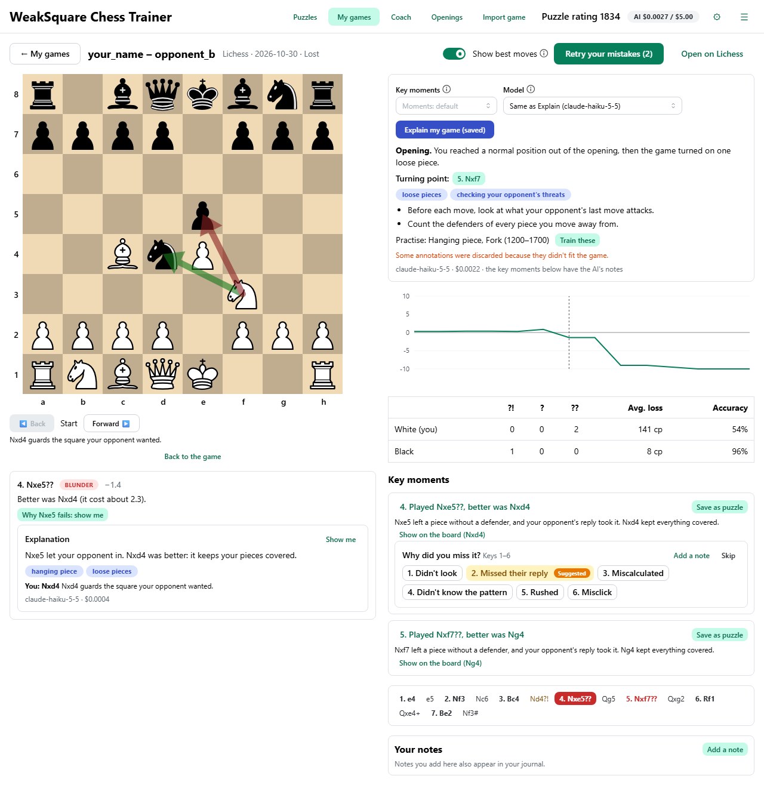

After about half a minute you get:
- a short summary of the **opening**,
- the **turning point** (click it to jump there),
- the **recurring themes** of your mistakes and 2–3 **takeaways**,
- a note on **each key moment** in the Key moments list, with **Show on the board** for its arrows and the better line,
- often a **puzzle recommendation**, for example *Practise: Hanging piece, Fork (1200–1700)*. **Train these** asks first, then sets the puzzle filters to those themes and that rating range and takes you to your puzzles. It replaces the themes and rating you had, and keeps **Match** (any or all) as you set it. Themes apply only to Lichess puzzles without a mix by ratio, so if **Puzzles from** was **My puzzles**, it switches to **Lichess DB**, and **Mix by ratio** turns off. Your other filters and your saved presets don't change.

The game then shows **AI-reviewed** in My games.

**Gotchas**
- **Saved explanations are free.** The same move, or the same game with the same number of key moments, on the same model, shows **(saved)** and costs nothing, even when the budget is used up. A new analysis at other settings, or other grading thresholds, gets a new explanation. Analyzing a game again sets it back to **Analyzed**.
- **What it costs:** Explain my game is roughly 10,000 input and 3,000 output tokens: about $0.003 on Claude Haiku 5.5, $0.05 on Claude Sonnet 5.5 and $0.14 on GPT-5.5. Explain this move costs about the same as one puzzle Explain. The [budget and the per-run cap](#what-it-costs-and-the-limits) apply.
- **Your side first:** the AI needs to know which side you played. If the app asks, answer it first.
- **What's sent:** see [Your data and privacy](#your-data-and-privacy). No names, ratings, dates, links or clocks.

### Games settings
In **Settings → Games**:

| Setting | What it does |
|---|---|
| **chess.com username** | Verify, Link or Unlink. |
| **Sync new games when the app opens** | On by default. |
| **First sync: days back / at most (games)** | How far the first sync of each account reaches (90 days, 200 games). |
| **Analysis: seconds per position** | Stockfish's time per position (0.3 s by default). A higher value is slower but more accurate. New analyses use it, and a game analyzed at another setting shows **Analyze again**. |
| **Key moments** | How many of your mistakes are listed (5). |
| **Retry tolerance (cp)** | How close to the best move counts as found, in Retry and in puzzles saved from your games (30). |
| **Inaccuracy / Mistake / Blunder from (cp)** | The grading thresholds (50, 100, 200). Games you've already analyzed are regraded at once, with no new analysis. Losing a forced mate, or walking into one, is always a blunder. |
| **Puzzles from your games** (v0.10) | Which of your mistakes become [puzzles](#puzzles-from-your-games): **Blunders only**, **Mistakes and blunders** (the default) or **Inaccuracies, mistakes and blunders**. Changing it archives or restores puzzles at once, with no new analysis. A mistake becomes a puzzle only if it has one clear answer, so inaccuracies add few. |
| **Checking a puzzle: seconds per position** (v0.10) | Stockfish's time per position when it checks that a puzzle's line has one clear answer at each step (1 s). |

### Gotchas
- **Analysis needs Stockfish.** Without it, **Analyze** says so. See [Installing Stockfish](#installing-stockfish).
- **Theme and habit tags** (v0.10): each mistake you missed or allowed is tagged with Lichess's puzzle themes (fork, pin, back-rank mate…) by Lichess's own tagger, and each of your inaccuracies, mistakes and blunders gets habit tags (*hung a piece*, *missed a free capture*, *ignored a threat*, *moved a defender*). The [Coach](#the-coach) counts them. Games analyzed before v0.10 are tagged once, in the background, the first time you start this version.

## Importing your own puzzles
*Added in v0.8.*

If you have puzzles in a file (for example from a book or a course you own), you can train on them in the app. The app doesn't ship, link to or download any puzzle collection.

1. Open **☰ → Import puzzles from a file…**.
2. Give the set a **label**, such as the book's title.
3. Press **Choose a file…** and pick a **PGN**, **EPD** or **CSV** file:
   - **PGN:** each game is a puzzle. Its `FEN` tag is the position, and its moves are the solution.
   - **EPD:** one position per line, with `pv` (the line) or `bm` (the best move) as the solution, and `id` as the name.
   - **CSV:** columns `fen`, `solution` (or `moves`, in UCI like `e2e4` or SAN like `Nf3`) and an optional `name`.
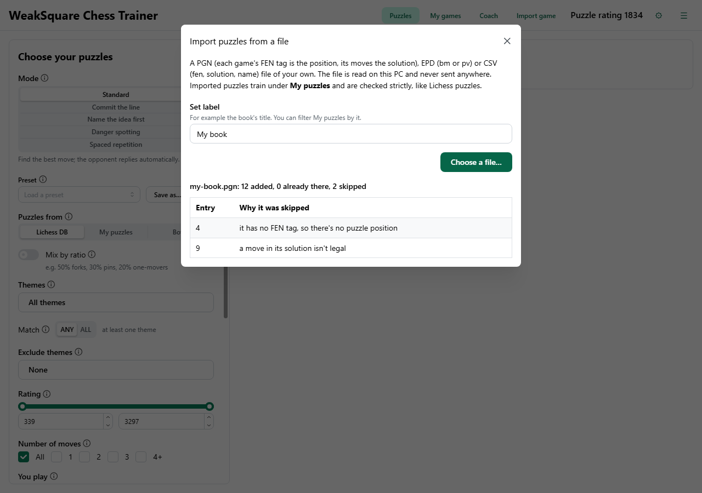

4. When it's done, the **report** shows how many puzzles were added, how many were already there, and which entries were skipped, with their entry number and why.

The side to move in each position is you. If a file gives only the first move, the puzzle is that move. Imported puzzles are checked **strictly**, like Lichess puzzles: only the file's moves count, except that any checkmate counts where the solution mates. Importing the same file again adds nothing twice, but the same file under another label is another set. From v0.10, imported puzzles are tagged with Lichess's themes on your PC (hidden until you've solved them). **The file is read on your PC and never sent anywhere.**

## My puzzles
*Added in v0.8.*

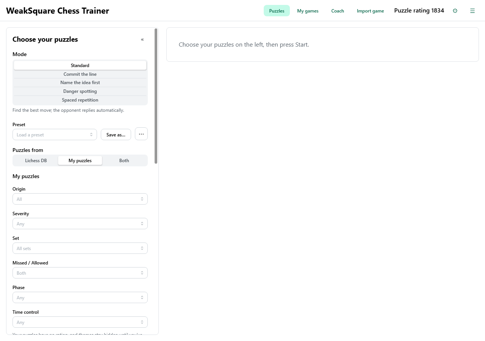

**My puzzles** holds the puzzles made from your games, the ones you saved yourself and the ones you imported. In **Choose your puzzles**, set **Puzzles from** to **My puzzles**, or to **Both** to mix them with Lichess puzzles in proportion to the two pools.

- **Filters:** origin (from my games, made automatically / saved from my games / imported), severity (blunders, mistakes, inaccuracies; v0.10), set, Missed or Allowed, phase and time control. **Number of moves**, **You play** and your history (Exclude solved here, Only my misses) apply too.
- **Not for My puzzles:** they have no rating, and their themes stay hidden until you've solved them, so themes, rating, openings, quality and ratios apply only to Lichess puzzles, and the order is always random. With My puzzles only, those controls are greyed out. (The [Suggested mix](#the-suggested-mix) is the one exception: it can use ratios with **Both**, and then a fixed share of the puzzles come from your games.)
- **Modes:** Standard, Commit the line and Spaced repetition. Name the idea and Danger spotting stay Lichess-only.
- **There's no opponent move first:** the puzzle starts in the position you solve, and you move first.
- **Checking moves:** a puzzle saved from your games accepts any move within the Retry tolerance of Stockfish's best, which Stockfish checks before the line continues from your move. Without Stockfish, only the saved line counts. In Commit the line, your line is graded against the saved one.
- They **never sync to Lichess** and have no rating. Misses come back in Spaced repetition like any puzzle, and Stats show their accuracy next to Lichess puzzles'.
- **After a puzzle from your games** (v0.10): **Open the game** opens it in Game Review at that move, and **Archive this puzzle** puts it away for good. It's kept with its attempts, but never comes up again.

### Puzzles from your games
*Added in v0.10.*

Every time one of your games is analyzed (from the Coach, **Analyze selected** or **Review**), the app turns your clear mistakes into puzzles, on your PC and for free.
- **Which mistakes:** the level in Settings → Games → **Puzzles from your games** (mistakes and blunders by default), from move 7 on.
- **Only clear ones:** Stockfish checks each one with Lichess's rules for a puzzle: the best move must be clearly better than any other, the game mustn't already be decided, and the line goes on only while each of your moves is the only good one. A one-move win of material isn't kept. A mate in one is kept unless another move also wins easily (Lichess's rule: the best move that doesn't mate must not leave you clearly winning).
- **Missed** (you had a tactic and didn't play it) is solved as you, from your position.
- **Allowed** (your move let your opponent in) is solved **as your opponent**, from the position after your mistake. The board turns to their side, and the puzzle says *Find what your opponent could have played*.
- **Solving:** any move within the Retry tolerance of Stockfish's best counts, as for puzzles you save yourself.
- A move you saved yourself keeps your puzzle, and no second one is made. Re-running never makes duplicates. Changing the level **archives** puzzles outside it (they keep their attempts) and brings them back when you widen it again, without analyzing your games again.
- Games you analyzed before v0.10 get their puzzles once, in the background, the first time you start this version (it needs Stockfish).
- Another player's games (see [the Coach](#the-coach)) never make puzzles.

## The Coach
*Added in v0.10.*

The Coach looks across many of your games and finds what costs you most: the tactics you miss, the ones you walk into, and the club-player habits behind them. From v0.11 it also reads your games the way a tutor would: openings, conversion, endgames, king safety and time use. It runs on your PC and is free. The AI part is optional.

### Running the Coach
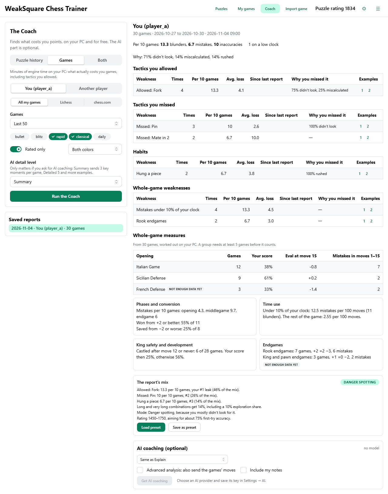

1. Press **Coach** at the top of the window.
2. Choose the **source**:
   - **Puzzle history:** your puzzle results per theme, here and (when you're signed in) on Lichess. No engine time.
   - **Games:** your games, analyzed by Stockfish. It takes minutes of engine time the first time, but shows what actually costs you games, including tactics you allowed.
   - **Both:** both, plus a table of themes you solve as puzzles but still miss or allow in games.
3. For games, choose **whose**: **You** (your linked accounts and imported games) or **Another player** (see below). For yourself, choose **All my games**, **Lichess** or **chess.com**. Then how many of the latest games (25, 50, 100 or 200), the time controls (rapid and classical by default: bullet and blitz mistakes are mostly about the clock), **Rated only**, and the color.
4. Press **Run the Coach**. If you're in the middle of a puzzle session when it finishes, the new mix's mode waits until that session ends. It syncs your accounts, analyzes the games that aren't analyzed yet (one at a time, with the time left and **Cancel**), tags the mistakes, makes [puzzles from them](#puzzles-from-your-games), and writes the report. You can keep solving puzzles meanwhile.

To coach a hand-picked set of games, tick them in **My games** and press **Send to Coach**. The Coach then uses exactly those games.

### The report
- **Per 10 games:** your blunders, mistakes and inaccuracies, how many came on a low clock, and the mix of your [mistake reasons](#mistake-reasons).
- **Tactics you allowed** and **Tactics you missed**, by Lichess theme, and your **Habits**, ranked by how often they happen and how much they cost. For each: how many times, how often **per 10 games**, the average eval it cost, the change since your last report (▼ is better), why you missed it (from your reason chips), and example moments. Click an example to open that position in Game Review; **← Coach** brings you back.
- **Puzzle themes you fail most** (Puzzle history or Both), with your first-try accuracy.
- **Puzzles vs. games** (Both): for example forks you solve 86% of the time as puzzles but allow 13 times per 10 games.
- **The report's mix:** a puzzle preset built from your top weaknesses, with the reasons. **Load preset** puts it in your puzzle filters (your saved presets don't change); **Save as preset** saves it.
- **Saved reports** are listed on the left. Click one to see it again.

Only your own moves count, and the first six moves (the opening) aren't counted in the tactics tables.

### Whole-game measures
*Added in v0.11.*

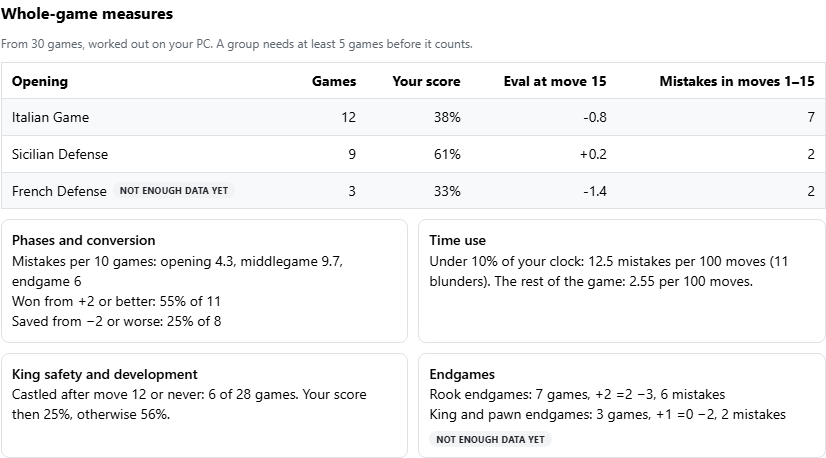

For a report on games, the app also writes a short summary of each game from its analysis (no extra engine time): the opening, the key moments, when each side castled, your development, the pawn structure after move 15, trades made while ahead or behind, the endgame type and your clock. From those, the report shows:
- **Openings:** for each opening family (for example *Sicilian Defense*), how many games, your score, the average eval at move 15 and your mistakes in the first 15 moves.
- **Phases and conversion:** mistakes per 10 games in the opening, middlegame and endgame; how often you **win from +2 or better** and **save the game from −2 or worse**. You have to hold it for a full move (your move and the reply), so a one-move swing doesn't count.
- **Time use:** your mistakes per 100 moves under 10% of your clock, against the rest of the game.
- **King safety and development:** how often you castle after move 12 or never, and your score when you do and don't.
- **Endgames:** results and mistakes per endgame type (king and pawn, rook, minor piece, queen, mixed).

**Not enough data yet:** a group needs at least **5 games** (5 Sicilians, 5 rook endgames…). With fewer, it's shown with that label and never counts as a weakness.

**Whole-game weaknesses** join the report's tables when a measure shows a problem: an opening you come out of badly, an endgame type where you make mistakes, winning positions you don't win, mistakes on a low clock (only when they're more frequent than the rest of the time) and castling late (only when it costs you points). They're ranked per 10 games, like the tactics. The Suggested mix stays made of tactics; a time weakness shows up in **Why this mix** instead.

### Another player
Choose **Another player**, type their username or paste their profile link (`lichess.org/@/…` or `chess.com/member/…`), and pick the site if the link doesn't say. The Coach fetches their latest public games, analyzes them and writes a report labelled with their name. Their games are kept apart from yours:
- They're **not in My games**, unless you choose them in the **Player** filter there.
- They make **no puzzles**, and they **never change your Suggested mix**, your stats or your report trends.
- **Load preset** and AI coaching work on their report too.

### The Suggested mix
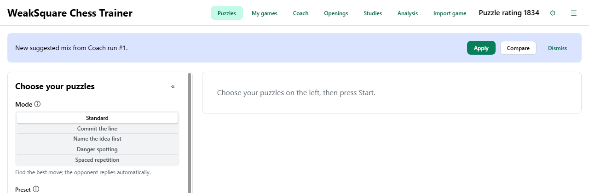

After each Coach run on your games, the app builds a **Suggested mix** and, if you haven't changed your filters by hand, makes it your puzzle selection. The main page then says *Suggested — from Coach run #N, <date>*. **Why this mix** explains it in plain words, for example *Allowed: Fork: 13.3 per 10 games, your #1 leak (46% of the mix)*.
- **Built from your weaknesses:** a share of puzzles for each of your top weaknesses, the bigger the leak the bigger the share, plus a share of **long combinations** (more when your missed tactics are long) that never drops below 10%.
- **The mode** follows your mistake reasons once a weakness has at least 5: mostly *didn't look* → **Danger spotting**, mostly *miscalculated* → **Commit the line**, mostly *unknown pattern* → the same themes at a lower rating. Mostly *rushed* is pointed out as a time issue.
- **Your own mistakes:** with Standard or Commit the line, 20% of the puzzles come from [your games](#puzzles-from-your-games).
- **Rating:** around your Lichess puzzle rating (1500 if unknown), adjusted so you solve about 75% at the first try.
- **It never overwrites your choices.** If you've changed your filters since the last suggestion, a banner appears instead: **Apply** uses the new mix, **Compare** shows your filters next to it, and **Dismiss** keeps yours.

### AI coaching (optional)
*Changed in v0.11.*

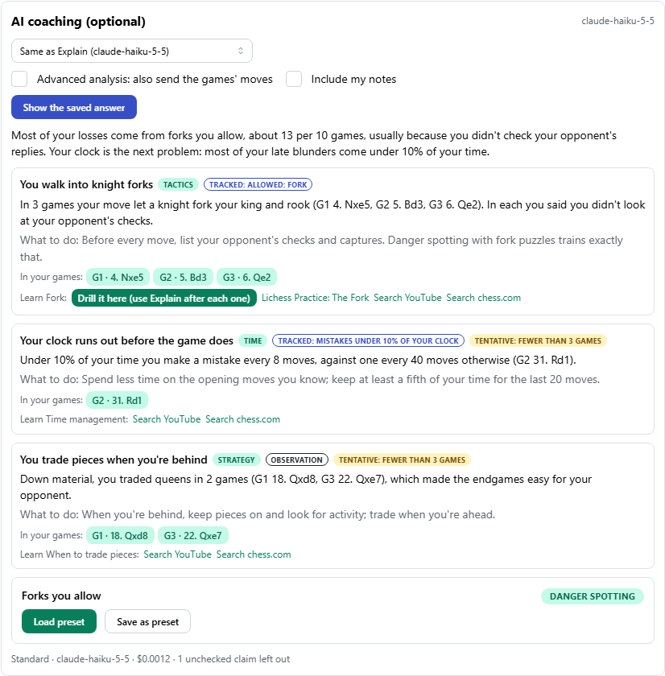

Under a report, **Get AI coaching** sends its numbers, the game summaries and a few example positions to the AI, which acts as a tutor. You get a short summary, 3–8 weaknesses across tactics, strategy, openings, endgames and time (and anything else it can show, not only those), and 1–3 puzzle presets you can **Load** or **Save**.
1. Pick its model right in the AI coaching box, or in **Settings → AI → Coach**: it's the same setting (**Same as Explain** by default).
2. Before the run, the **AI detail level**: **Summary** (3 key moments per game, 12 example positions) or **Detailed** (5 key moments per game, 20 positions with the moves before each).
3. Optionally tick **Advanced analysis** or **Include my notes** (below). Both are off every time you open a report.
4. Press **Get AI coaching**, read the estimate and press **Confirm**.

**Each weakness:**
- a category (Tactics, Strategy, Opening, Endgame, Time, Other), what goes wrong and **What to do**;
- **In your games:** the moves that show it, such as **G3 · 23... Nf6**. Click one to open that game in Game Review at that move; **← Coach** brings you back. Games are labelled G1, G2… in the order of the report. Every move the AI cites is checked against the games that were sent, and a weakness with no real move behind it is left out (the footer says how many claims were left out).
- **Tracked: <weakness>** when it's one of the report's measured weaknesses, or **Observation** when the app can't measure it. An observation found again in a later report says **Seen in N reports**.
- **Tentative** when it rests on fewer than 3 games.
- **Learn it:** see [Lesson pointers](#lesson-pointers).

**Every answer is kept.** A report can have several AI answers: standard, Advanced, with notes, on different models. **Answers for this report** switches between them, and findings that no earlier answer had are marked **New in this run**. Asking again with the same options and model shows the saved answer for free (**Show the saved answer**).

The AI's presets are checked like any filter: unknown themes and impossible values are dropped, and if none is usable you get the report's own mix. The [budget and the per-run cap](#what-it-costs-and-the-limits) apply, and the estimate before **Confirm** shows the real cost. For what it sends, see [Your data and privacy](#your-data-and-privacy). Reports on your puzzle history only (no games) get the v0.10 coaching, without these options.

### Advanced analysis
*Added in v0.11.*

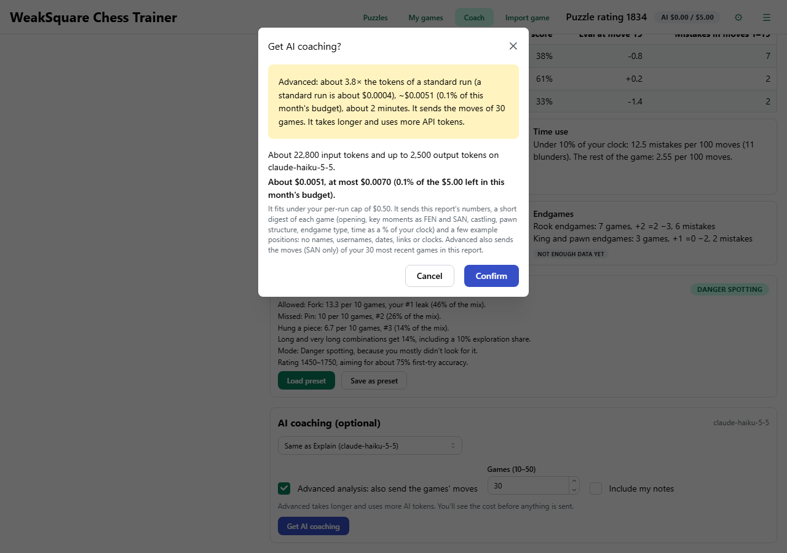

**Advanced analysis** also sends the moves of your most recent games in the report (SAN only, for example `1. e4 e5 2. Nf3`), so the AI can see whole games and not only their summaries. Choose how many games, **10–50** (30 by default).
- **Before Confirm** you see how it compares with a standard run, for example *about 3.8× the tokens of a standard run, ~$0.40 (8% of this month's budget), about 2 minutes*. It takes longer and uses more API tokens. The per-run cap and the monthly budget block it like any request.
- **Never automatic:** it's off every time you open a report, and nothing turns it on for you.
- Still **no names, ratings, dates, links, clocks or comments**: the app rebuilds the moves from the games themselves.

### Include my notes
*Added in v0.11.*

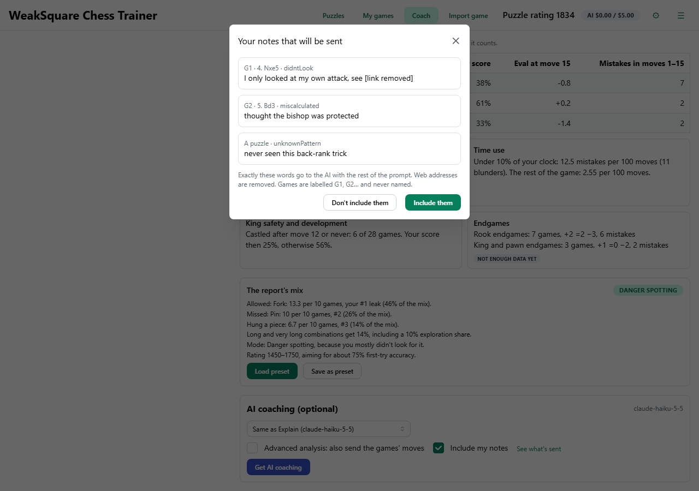

Your [mistake-reason](#mistake-reasons) notes often say what you were thinking. **Include my notes** adds them to the request: your latest reason and note for each move of yours in the report's games (including Retry), and your puzzle notes since the report's first game.
- Ticking it opens **Your notes that will be sent**: exactly the words that go, each with its game label and move. **Don't include them** unticks it.
- Web addresses in your notes (links like `https://…`, `www.…`, `youtu.be/…` or `bit.ly/…`) are removed before the preview and before sending.
- It's off every time you open a report. It's only offered on your own reports.

### Lesson pointers
*Added in v0.11.*

A weakness the AI tied to a lesson topic has **Learn <topic>:**
- **Drill it here:** loads that topic's puzzles in Standard mode, 200 below your usual rating band. Use **Explain** after each one.
- **Lichess Practice / Lichess Learn** pages for that topic, when there is one (free, no account needed).
- **Search YouTube**, **Search chess.com** and **Search my site**, which search that site for the topic.

The links open in your default browser. The AI only picks the topic; every link is built by the app (the AI never writes a web address), and the app never visits those sites itself. Choose which search links appear, and add your own search site, in **Settings → Coach**: an `https://` address with `{q}` where the search words go, for example `https://example.org/search?q={q}`.

### Gotchas
- **The first run on your games takes a while:** Stockfish analyzes every move at 0.3 s (Settings → Games), so 50 new games take about 20 minutes. Games already analyzed are reused, and every game the Coach analyzed opens in Game Review at once.
- **Games without a known side** (an imported game where you didn't say which side you played) aren't counted.
- **Checkpoints and tracking whether a weakness is fixed** come in a later version. Until then, compare reports with the change column.
- **Whole-game measures need enough games:** with 25 games, few openings or endgame types reach 5 games. Run the Coach on 50 or more for them to count.
- **The game summaries come from the analysis.** If you change the analysis settings (think time or grading thresholds), the summaries are rebuilt from the new analysis the next time you run the Coach.

## Keyboard shortcuts
*Added in v0.2.*

| Key | What it does |
|---|---|
| **N** or **Enter** | Next puzzle (before the puzzle is decided, that's Skip, which counts as failed). On the session summary, a new session. |
| **H** | Hint |
| **A** | Show answer (once it's unlocked; after the puzzle, back to the start of the answer) |
| **R** | Try again (not scored), once the puzzle is over (v0.4) |
| **←** / **→** | Step back / forward through the answer, through your moves on the analysis board, or through a line you chose with **Show me** (v0.4). In Game Review: through the game, or a line you're stepping through (v0.8) |
| **C** | Show or hide the letters and numbers around the board |
| **F** | Hide or show the filters panel (v0.5) |
| **S** / **U** | Danger spotting: call the highlighted move Safe or Unsafe (v0.6) |
| **1**–**6** | After a failed puzzle: pick why you missed it (v0.6) |
| **?** | The list of shortcuts (also in **☰ → Keyboard shortcuts**) |

Shortcuts do nothing while you're typing in a box or a dialog is open, and a key does nothing when its button is greyed out.

**Board coordinates:** press **C**, choose **☰ → Hide board coordinates** / **Show board coordinates**, or use the switch in **Settings**. Your choice is saved.

## Appearance and sounds
*Added in v0.2.*

Click the gear (**⚙**, top right) or choose **☰ → Settings…** to change how the app looks and sounds. *Changed in v0.5:* it also has a **Training** section (see [Training settings](#training-settings)). *Changed in v0.4:* it also has an **Engine** section (see [Engine settings](#engine-settings)). *Changed in v0.3:* the same dialog starts with **Lichess account**, where you sign in or out (see [Signing in with Lichess](#signing-in-with-lichess-syncing-solves-offline-mode)). Every change applies at once and is saved on this PC, so the app starts the same way next time.

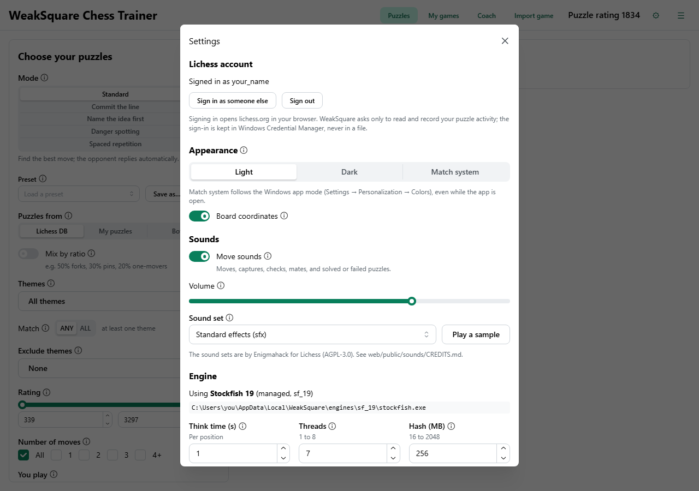

| Setting | What it does |
|---|---|
| **Appearance: Light / Dark / Match system** | The color scheme for every screen. **Light** is the default. **Match system** follows the Windows app mode (Settings → Personalization → Colors → *Choose your app mode*) and switches as soon as you change it, even with WeakSquare open. The board keeps its usual colors in every scheme. |
| **Board coordinates** | The letters and numbers around the board (also **C**). |
| **Move sounds** | On by default. Sounds for your moves and the opponent's (a move, a capture, a check, a mate), and for a solved or failed puzzle. Off is completely silent. |
| **Volume** | 70% by default. |
| **Sound set** | **Standard effects (sfx)** (the default), **Piano**, **8-bit (NES)** or **Futuristic**. **Play a sample** plays a capture in the chosen set. |

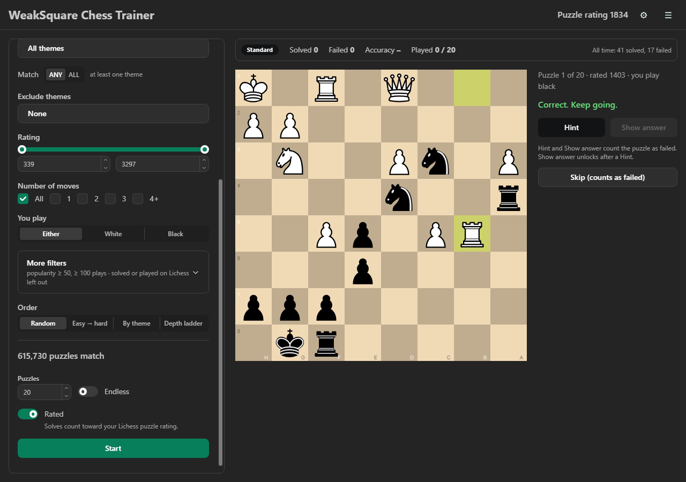

**Gotchas**
- The app opens in your saved scheme straight away. If WeakSquare can't read the saved setting within a second and a half, it opens in Light and switches as soon as it can.
- Castling plays the ordinary move sound, because none of the sets has a castling sound. In these sets, checkmate uses the check sound. A mate plays only that sound (not also a capture or a check), followed by the solved sound.
- A new sound cuts off the one before, so fast moves never pile up.
- The sounds are Lichess's sets by Enigmahack, licensed AGPL-3.0 like this app. They're bundled with the app, so nothing is downloaded when they play.

## Installing from source
*Added in v0.1. Changed in v0.2: a desktop shortcut and the app icon.*

WeakSquare runs from its source code; there's no installer to download. You need Windows 10 or 11 with **Git**, **Python 3.12 or newer** and **Node.js LTS** installed.

1. Open PowerShell (or a Command Prompt) in the folder where you want the app, and run:
   ```powershell
   git clone https://github.com/adamwp1993/weaksquare-chess-trainer
   cd weaksquare-chess-trainer
   python scripts/setup.py
   ```
2. Setup takes a few minutes. It installs everything into the project folder, builds the app, downloads and imports the puzzle database (see *Getting started*), installs Stockfish (*Added in v0.4*; add `--skip-engine` to install it from the app later), and adds **WeakSquare Chess Trainer** to your Start menu and your desktop. To skip the puzzle download, add `--skip-puzzle-db`; the app then offers it on first run.
3. Start the app from the Start menu or the desktop.

Both shortcuts, the window and its taskbar button show the WeakSquare icon: four board squares with a black queen. `--no-desktop-shortcut` skips the desktop one, and `--no-shortcut` skips both. If your Desktop is in OneDrive, the shortcut goes there, where Windows shows it.

**Updating:** in the same folder, run `git pull`, then `python scripts/setup.py` again. Setup skips anything that's already up to date, and your data isn't touched.

**Gotchas**
- If setup says uv isn't on your PATH, that's fine: setup carries on without it.
- Only one copy of the app runs at a time. Starting it again brings the open window to the front.
- Running setup again replaces the two shortcuts rather than adding more. If you deleted the desktop shortcut on purpose, use `--no-desktop-shortcut` next time.
- A shortcut you pinned to the taskbar yourself, before v0.2, keeps its old icon. Unpin it and pin the app again.

## The About screen
*Added in v0.1. Changed in v0.4: the Stockfish row.*

Open the menu (**☰**, top right) and choose **About** to see:

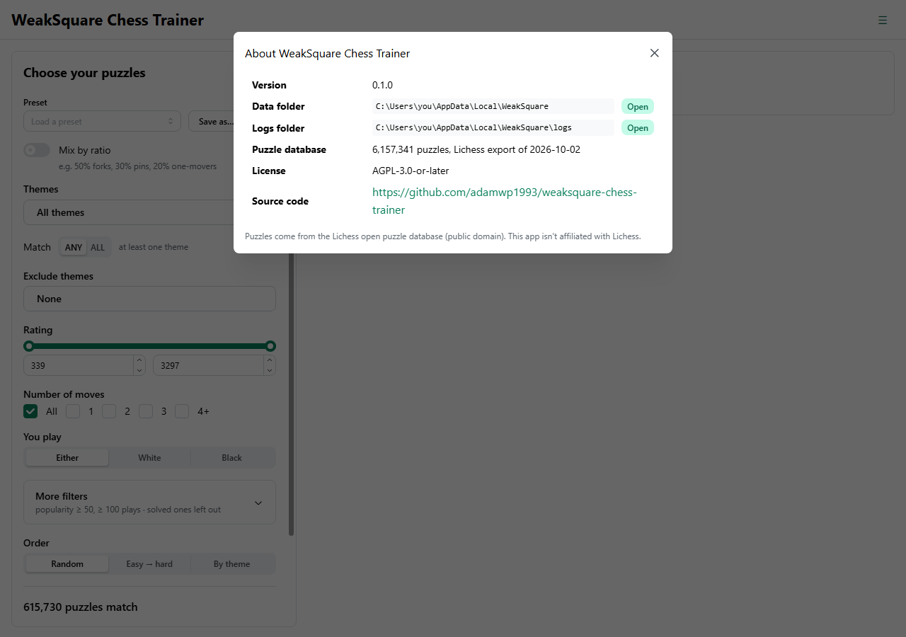


| Item | What it shows |
|---|---|
| **Version** | The app version you're running. |
| **Data folder** | Where your puzzles, attempts and settings live. **Open** shows it in File Explorer. |
| **Logs folder** | Log files that help diagnose problems. **Open** shows it in File Explorer. Sign-in tokens and keys are removed before anything is written. |
| **Puzzle database** | How many puzzles are imported, and the date of the Lichess export they came from. |
| **Stockfish** | *Added in v0.4.* The engine in use (Stockfish 19, or your own) and where its program file is, or that it isn't installed. |
| **License** and **Source code** | The app is open source under AGPL-3.0-or-later. The link opens the code in your browser. |
